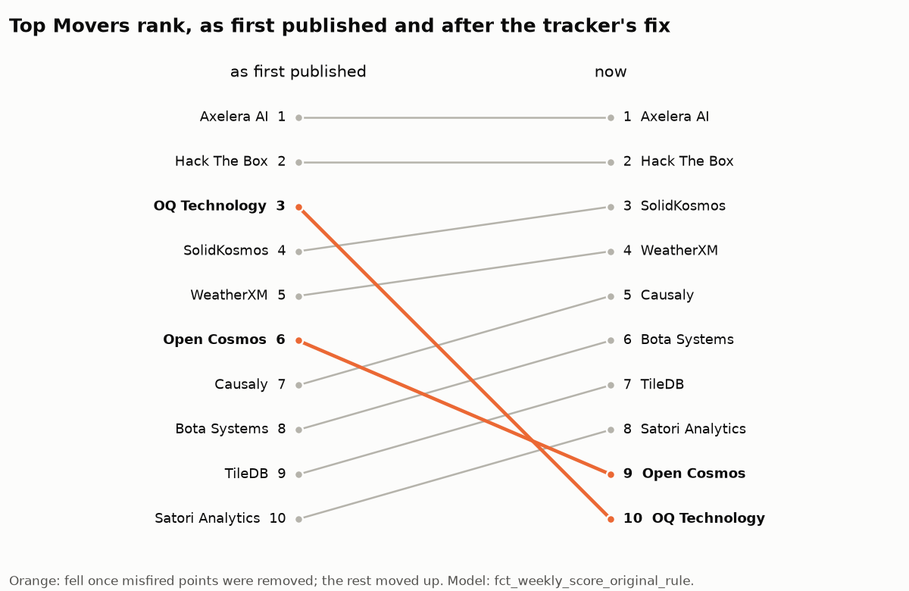
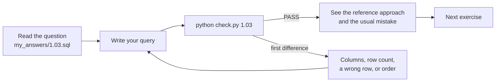
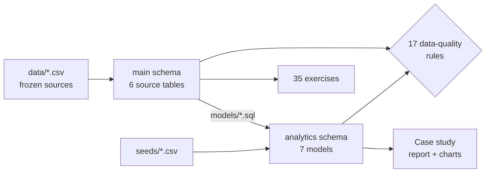

# SQL for VC analysis: Greek deep tech deal flow

Venture analysis in SQL on real data: 88 Greek deep-tech companies with their investors and rounds, plus four weeks of hiring, GitHub, news and EU-grant signals. The data comes from two of my other projects, the [Greek Deep Tech Market Map](https://github.com/geve-ops/greek-deeptech-market-map) and the weekly [deal-flow tracker](https://github.com/geve-ops/vc-dealflow-tracker). It runs on [DuckDB](https://duckdb.org/), whose SQL is close to PostgreSQL and Snowflake.

| Part | What it shows |
|---|---|
| **[Case study](case_study/README.md)** | Six questions a Greek VC fund would ask, answered with the queries, results, charts, a "so what" for each and five recommendations. Every table and every number in the text is generated from a query. |
| **[Analytics layer](docs/architecture.md)** | Messy source data modelled into 7 clean, tested tables (`dim_company`, `fct_last_round`, `bridge_company_fund`, `fct_signal`, `fct_weekly_score`, `company_momentum`, `fct_weekly_score_original_rule`), with 17 data-quality rules and a schema contract. |
| **[Learning kit](#learning-path)** | 35 graded exercises in five levels, from `SELECT` to window functions and data-quality checks, with a checker and an explained reference answer for each. |

## Findings

Data as of the tracker's weekly run of 16 November 2026.

<!-- findings:start -->
| Question | Finding |
|---|---|
| [Do the target funds co-invest?](case_study/README.md#2-which-greek-funds-lead-and-do-the-target-funds-co-invest) | Rarely. Big Pi, Marathon, Metavallon, Velocity and egg share 1 company between them (Anodyne Nanotech). Their Greek co-investors are smaller early-stage funds. |
| [How is recent capital spread?](case_study/README.md#3-how-is-recent-capital-spread) | The median confirmed round since January 2025 is EUR 1.18M in euros and USD 6.75M in dollars. One company, Open Cosmos, is 89.6% of the euro total. |
| [Who brings in EU money?](case_study/README.md#4-who-brings-in-eu-research-money) | Of the five companies in the most CORDIS projects, 0 have a Greek fund investor: a sourcing list. |
| [Can the momentum ranking be trusted?](case_study/README.md#5-what-drives-momentum-and-can-the-ranking-be-trusted) | Not at first. 25 of 114 published points came from headlines that announced no round, which put OQ Technology at number 3 instead of 10. The audit led to a fix in the tracker and a rescore of its history. |
| [Who to call this month?](case_study/README.md#6-who-should-a-fund-call-this-month) | 12 companies are 15 to 24 months past their last round; 7 of them have no Greek investor. |
<!-- findings:end -->

The audit in section 5 found two scoring errors in the tracker. They were fixed upstream, and the tracker's history was rescored:



## Quick start

Python 3.10 or newer.

```
git clone https://github.com/geve-ops/sql-for-vc-analysis.git
cd sql-for-vc-analysis
pip install -r requirements.txt
python run_all.py
```

`run_all.py` builds the database from the CSV files in [data/](data/), runs every reference answer and the test suite, and regenerates the case study. It takes a few seconds and ends with `All steps passed.` With `pip install -r requirements-dev.txt` it also lints the SQL and Python first, exactly as [CI](.github/workflows/ci.yml) does.

## Learning path

Work through the levels in order. Each exercise is a question an analyst would be asked, with the columns to return, the sort order and a hint you can expand.

| Level | You learn | Exercises | Example question |
|---|---|---|---|
| [1](exercises/level1.md) | `SELECT`, `WHERE`, `ORDER BY`, `GROUP BY`, `HAVING`, `NULL` | 1.01 to 1.08 | Which companies with a GitHub organisation have no Greek investor? |
| [2](exercises/level2.md) | inner and left joins, anti-joins, filters in `ON` vs `WHERE` | 2.01 to 2.07 | Which companies showed no activity at all this week? |
| [3](exercises/level3.md) | CTEs, `CASE`, dates, regex parsing of messy text, splitting lists | 3.01 to 3.08 | Which companies are in the 15 to 24 month raising window? |
| [4](exercises/level4.md) | `RANK`, `ROW_NUMBER`, `LAG`, running totals, share of total | 4.01 to 4.07 | Capstone: rebuild the tracker's Top Movers ranking in SQL. |
| [5](exercises/level5.md) | data quality and modelling: grain checks, `FULL OUTER JOIN`, classification rules, gaps and islands | 5.01 to 5.05 | Which job postings opened and closed this week? |

For each exercise:



1. Write your query in `my_answers/<id>.sql`. The file already holds the question.
2. Run `python check.py 1.03`. You see your result and either `PASS` or the first difference: column count, row count, a wrong row, or the right rows in the wrong order.
3. On a pass, the checker shows the reference approach and the usual mistake. The full answer is in [answers/](answers/). There is usually more than one correct query, since the checker compares results, not SQL text.

| Command | Does |
|---|---|
| `python check.py 1.03` | check your answer |
| `python check.py 1.03 --expected` | show the expected result (not the SQL) |
| `python check.py --list` | show your progress |
| `python check.py --run "SELECT ..."` | run any query, or a `.sql` file |

Checking rules: the number of columns and the values must match; column names do not have to. Numbers match within 0.01. Every exercise states its sort order, and order is checked.

Keep the [SQL reference card](docs/sql_reference_card.md) open while you work. To browse the tables, run `python check.py --run "DESCRIBE watchlist"`, or open `dealflow.duckdb` in the [DuckDB CLI](https://duckdb.org/docs/installation/), DBeaver, or VS Code with a DuckDB extension.

## The data

| Table | Rows | One row per |
|---|---:|---|
| `companies` | 88 | company on the market map, with stage, last round, investors and source links |
| `watchlist` | 69 | company the tracker follows, with GitHub, job board and Greek fund tags |
| `scores` | 276 | company per weekly run: points for funding news, grants, press, hiring and GitHub |
| `signals` | 2,623 | item seen in a weekly snapshot: repo, headline, job posting or CORDIS project |
| `pipeline` | 8 | company in the analyst pipeline |
| `backtest` | 15 | company with a known round, with its GitHub commits before the round |

These source tables sit in the `main` schema. The `analytics` schema holds the models built from them. The **[data dictionary](docs/data_dictionary.md)** describes every column of both, with a schema diagram.

**Sources.** Company facts and round figures come from the market map, which keeps a source link for every company. Signals come from GitHub, Google News, the companies' job boards and the EU's [CORDIS](https://cordis.europa.eu/) database, collected weekly by the tracker. No figure is estimated: where a source gives only an approximation or an unverified number, the models record its status and leave the amount empty.

**Limits.** 69 companies and four weekly runs: enough to learn SQL and to describe this watchlist, but not to show trends. Round sizes are the last round only, in the source's currency. Fund tags miss holdings no source mentions. EU grant amounts are whole-project budgets, not the company's share. Funding headlines are tagged by keyword. The [full list](docs/data_dictionary.md#limits-of-the-data) is in the data dictionary.

## How it is built



The [architecture page](docs/architecture.md) has the full system diagram, the model lineage from each source table to each case study question, and the quality gates.

- **Models parse each messy field once.** Every query that needs a round size reads `fct_last_round.is_usable`, so the rule for what counts cannot drift between queries. [Architecture](docs/architecture.md)
- **The tests cover the data as well as the code.** Each [data-quality rule](tests/data_quality/) is a query that returns the rows breaking it: keys, references between tables, accepted values, score arithmetic, model grain and a schema contract. One rule rebuilds the tracker's original scores from the raw signals and checks them row for row against the scores as first published. Every exercise is also checked against its reviewed result, the capstone against the tracker's published digest, the checker's own rules are unit-tested, and the counts this page states are checked against the files.
- **Lint and CI.** `sqlfluff` and `ruff` enforce the [SQL style guide](docs/sql_style.md) and the Python style. CI runs `run_all.py` on every push and fails if the committed report no longer matches the data.
- **The data is committed; the database is not.** `data/` holds the source CSVs (about 0.9 MB), so a fresh clone builds on its own. `dealflow.duckdb` is a binary file that changes with every build and depends on the DuckDB version, so it is rebuilt each time, which takes about a second.
- **The data is frozen at 16 November 2026**, so the exercises, the reviewed results and the report stay consistent. [data/manifest.json](data/manifest.json) records the source commits. To refresh, run `python run_all.py --refresh` with the two source repositories beside this folder (or set `DEALFLOW_TRACKER_DIR` and `MARKET_MAP_DIR`). Then review the changed results and accept them with `--update-expected`.

## Repository layout

```
README.md                 this page (the findings block is generated)
run_all.py                lint, build, test and rebuild everything
build_db.py               data/*.csv -> main schema -> seeds and models -> analytics schema
check.py                  the exercise checker
data/                     source CSVs and manifest.json
seeds/                    hand-kept reference data (target funds, scores as first published)
models/                   SQL models for the analytics schema, run in file order
exercises/                the five exercise sheets
my_answers/               your queries, one file per exercise
answers/                  reference answers, each with its approach and the usual mistake
case_study/               the report (README.md), queries/, charts/, template.md, findings.md, build_report.py
tests/                    data-quality rules, reviewed exercise results, kit tests
docs/                     architecture, data dictionary, SQL style guide, SQL reference card
.github/workflows/ci.yml  CI: the same checks on every push
requirements.txt          duckdb, matplotlib (requirements-dev.txt: sqlfluff, ruff)
```
