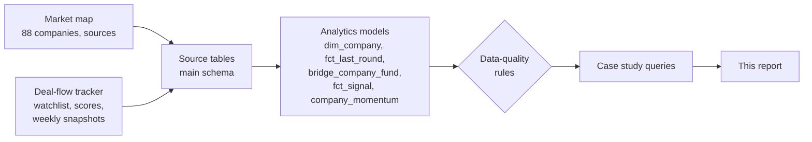
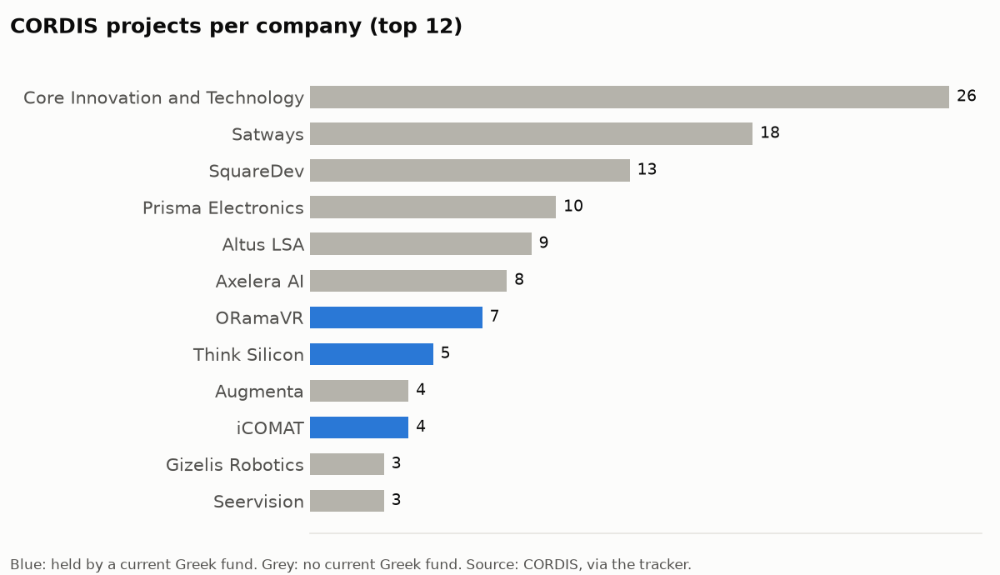
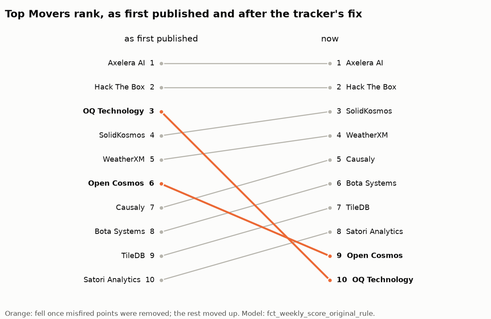

# Greek deep tech through a VC lens: six questions answered in SQL

*Data as of the weekly run of 16 November 2026. Generated by [build_report.py](build_report.py) from the queries in [queries/](queries/): no table and no figure on this page is typed by hand.*

## Executive summary

A Greek early-stage fund looking at deep tech wants to know where the companies are, who already backs them, how big the rounds are, and whom to call next. I took the 69 companies that the [Greek Deep Tech Market Map](https://github.com/geve-ops/greek-deeptech-market-map) rates Include or Borderline, joined them to 4 weeks of hiring, GitHub, news and EU-grant signals from my [deal-flow tracker](https://github.com/geve-ops/vc-dealflow-tracker), and answered six questions in SQL.

| # | Question | Answer |
|---|---|---|
| 1 | [Where is the universe, and how visible is it?](#1-where-is-the-universe-and-how-visible-is-it) | 48 of 69 companies sit in four sectors. Health & Biotech is the most backed (10 of 13); Space & Defense shows the most activity. |
| 2 | [Which funds lead, and do the target funds co-invest?](#2-which-greek-funds-lead-and-do-the-target-funds-co-invest) | Rarely: the target funds share 1 company between them (Anodyne Nanotech). |
| 3 | [How is recent capital spread?](#3-how-is-recent-capital-spread) | Median confirmed round since 2025: EUR 1.18M and USD 6.75M. One round is 89.6% of the euro total. |
| 4 | [Who brings in EU research money?](#4-who-brings-in-eu-research-money) | Of the five most active EU project partners, 0 have a Greek fund investor. |
| 5 | [What drives momentum, and can the ranking be trusted?](#5-what-drives-momentum-and-can-the-ranking-be-trusted) | Hiring and GitHub. An audit found that 25 of the 114 points first published came from headlines that announced no round. The tracker has since been fixed and its history rescored. |
| 6 | [Who should a fund call this month?](#6-who-should-a-fund-call-this-month) | 12 companies are in the raising window; 7 have no Greek investor. |

**Recommendations for a Greek fund**

1. **Source where local money is thin.** Space & Defense and the grant-heavy companies show activity with little Greek VC behind them. Health & Biotech is already crowded.
2. **Build syndicates through the early-stage funds.** The larger Greek funds rarely co-invest with each other; Evercurious VC and Genesis Ventures are the connectors.
3. **Size tickets to the euro market.** Most confirmed euro rounds are under EUR 5M. The median matters more than the total, which a single round dominates.
4. **Start this month's calls with the raising window.** Achira AI, Bitloops, Brainomix, Intryc, Keragon, Robenso, SquareDev have no Greek investor yet. Settle the facts the market map still marks UNVERIFIED before the first call.
5. **Audit a ranking before acting on it.** The momentum ranking moved companies by up to 7 places on headlines that announced nothing. Rerun the section 5 audit after every data refresh.

## Data and method



- **Universe:** the 69 watchlist companies, out of 88 on the market map. Company facts, round figures and investors come from the market map, which keeps a source link for every company; tables that quote a figure link to it.
- **Signals:** GitHub, Google News, the companies' job boards and the EU's [CORDIS](https://cordis.europa.eu/) database, collected weekly by the tracker over 4 runs.
- **Models:** the free-text fields are parsed once, in [models/](../models/), and every query here reads the cleaned tables. The [data dictionary](../docs/data_dictionary.md) documents every column.
- **Rules:** a round size counts only when the source gives an exact amount and a confirmed date. Approximate (`~`), lower-bound and UNVERIFIED figures are left out and listed. Currencies are never converted. Before this report is built, the data must pass the [data-quality rules](../tests/data_quality/): unique keys, referential integrity, accepted values, score arithmetic and a schema contract.
- **Target funds:** Big Pi Ventures, Marathon VC, Metavallon VC, Velocity Partners and egg (Eurobank), listed in [seeds/target_fund.csv](../seeds/target_fund.csv). egg has no tagged holding on the watchlist.

---

## 1. Where is the universe, and how visible is it?

**Why it matters.** A fund needs to know where the companies are, and how much of each sector it can actually see: how many already have a Greek investor, how many have a round size it can trust, and how many show any activity.

| sector | companies | include | greek_fund_backed | confirmed_round_size | scored_in_4_weeks | pct_of_watchlist |
|---|---:|---:|---:|---:|---:|---:|
| Health & Biotech | 13 | 6 | 10 | 10 | 3 | 18.8 |
| Robotics & Drones | 13 | 7 | 6 | 5 | 4 | 18.8 |
| AI & Machine Learning | 11 | 4 | 4 | 8 | 5 | 15.9 |
| Space & Defense | 11 | 5 | 4 | 6 | 6 | 15.9 |
| Energy & Climate Tech | 8 | 5 | 6 | 5 | 1 | 11.6 |
| Semiconductors & Hardware | 7 | 4 | 4 | 1 | 2 | 10.1 |
| Industrial & Manufacturing Tech | 5 | 4 | 1 | 2 | 1 | 7.2 |
| Quantum & Advanced Computing | 1 | 1 | 0 | 0 | 0 | 1.4 |

<details><summary>SQL: <code>queries/01_sector_coverage.sql</code></summary>

```sql
-- Q1. Where is the investable universe, and how much of it can a fund actually see?
-- One row per sector of the watchlist (the market map's Include and Borderline companies).
SELECT
    d.sector,
    count(*)                                                        AS companies,
    count(*) FILTER (WHERE d.map_status = 'Include')                AS include,
    count(*) FILTER (WHERE d.greek_fund_status = 'current')         AS greek_fund_backed,
    count(*) FILTER (WHERE r.amount_status = 'confirmed')           AS confirmed_round_size,
    count(*) FILTER (WHERE m.score_4_runs > 0)                      AS scored_in_4_weeks,
    round(100.0 * count(*) / sum(count(*)) OVER (), 1)              AS pct_of_watchlist
FROM analytics.dim_company AS d
JOIN analytics.fct_last_round AS r ON r.company_id = d.company_id
JOIN analytics.company_momentum AS m ON m.company_id = d.company_id
WHERE d.on_watchlist
GROUP BY d.sector
ORDER BY companies DESC, d.sector;
```
</details>

**So what.**
- Four sectors (Health & Biotech, Robotics & Drones, AI & Machine Learning, Space & Defense) hold 48 of the 69 companies.
- Health & Biotech is the most crowded for a new investor: 10 of its 13 companies already have a current Greek fund.
- Space & Defense has the most companies producing signals (6 of 11) but only 4 with a Greek fund. Activity runs ahead of local backing there.
- Semiconductors & Hardware has a confirmed round size for 1 of its 7 companies. Any sizing view of that sector needs primary diligence first.

## 2. Which Greek funds lead, and do the target funds co-invest?

**Why it matters.** Co-investors decide who leads, who follows and who brings the next round. The query splits the multi-fund `greek_funds` cell into one row per fund (the `bridge_company_fund` model), then joins that table to itself to find funds that hold the same company.


| fund | current_holdings | shared_with_another_greek_fund | greek_co_investors | target_fund |
|---|---:|---:|---:|---|
| Genesis Ventures | 9 | 3 | 3 | no |
| Marathon VC | 8 | 1 | 1 | yes |
| Big Pi Ventures | 7 | 2 | 3 | yes |
| Metavallon VC | 7 | 1 | 1 | yes |
| Evercurious VC | 5 | 3 | 4 | no |
| Uni.Fund | 3 | 2 | 2 | no |
| Velocity Partners | 2 | 1 | 2 | yes |
| Phaistos Investment Fund | 1 | 0 | 0 | no |
| Starttech Ventures | 1 | 1 | 2 | no |
| egg (Eurobank) | 0 | 0 | 0 | yes |

<details><summary>SQL: <code>queries/02_fund_overlap.sql</code></summary>

```sql
-- Q2a. Which Greek funds hold the most watchlist companies, and how often do they co-invest?
-- One row per fund with a current holding, plus any target fund with none.
WITH holdings AS (
    SELECT company_id, fund, is_target_fund
    FROM analytics.bridge_company_fund
    WHERE is_current
),
co_investment AS (
    SELECT
        h.fund,
        count(DISTINCT o.fund)          AS greek_co_investors,
        count(DISTINCT o.company_id)    AS shared_companies
    FROM holdings AS h
    JOIN holdings AS o ON o.company_id = h.company_id AND o.fund <> h.fund
    GROUP BY h.fund
),
funds AS (
    SELECT fund, count(*) AS current_holdings, bool_or(is_target_fund) AS target_fund
    FROM holdings
    GROUP BY fund
    UNION ALL
    SELECT t.fund, 0, TRUE
    FROM analytics.ref_target_fund AS t
    WHERE t.fund NOT IN (SELECT h.fund FROM holdings AS h)
)
SELECT
    f.fund,
    f.current_holdings,
    coalesce(c.shared_companies, 0)     AS shared_with_another_greek_fund,
    coalesce(c.greek_co_investors, 0)   AS greek_co_investors,
    f.target_fund
FROM funds AS f
LEFT JOIN co_investment AS c ON c.fund = f.fund
ORDER BY f.current_holdings DESC, f.fund;
```
</details>

Every pair of Greek funds that currently share a company:

| fund_a | fund_b | shared | companies |
|---|---|---:|---|
| Big Pi Ventures | Evercurious VC | 2 | Anodyne Nanotech, ORamaVR |
| Big Pi Ventures | Starttech Ventures | 1 | ORamaVR |
| Big Pi Ventures | Velocity Partners | 1 | Anodyne Nanotech |
| Evercurious VC | Starttech Ventures | 1 | ORamaVR |
| Evercurious VC | Uni.Fund | 1 | SolidWatts |
| Evercurious VC | Velocity Partners | 1 | Anodyne Nanotech |
| Genesis Ventures | Marathon VC | 1 | Progressive Robotics |
| Genesis Ventures | Metavallon VC | 1 | Feel Therapeutics |
| Genesis Ventures | Uni.Fund | 1 | Terra Robotics |

<details><summary>SQL: <code>queries/02b_fund_pairs.sql</code></summary>

```sql
-- Q2b. Every pair of Greek funds that currently hold the same watchlist company.
SELECT
    a.fund                                              AS fund_a,
    b.fund                                              AS fund_b,
    count(*)                                            AS shared,
    string_agg(d.company, ', ' ORDER BY d.company)      AS companies
FROM analytics.bridge_company_fund AS a
JOIN analytics.bridge_company_fund AS b
    ON b.company_id = a.company_id AND a.fund < b.fund AND b.is_current
JOIN analytics.dim_company AS d ON d.company_id = a.company_id
WHERE a.is_current
GROUP BY a.fund, b.fund
ORDER BY shared DESC, fund_a, fund_b;
```
</details>

**So what.**
- By watchlist holdings, Genesis Ventures (9) leads, ahead of Marathon VC (8), Big Pi Ventures (7) and Metavallon VC (7).
- The target funds share 1 company between them: Anodyne Nanotech. Marathon VC and Metavallon VC each co-invest with one other Greek fund, and it is not a target fund.
- Where Greek funds do co-invest, the partner is usually a smaller early-stage fund: Evercurious VC has 4 Greek co-investors and Genesis Ventures 3. They are the likeliest route into a local syndicate.
- 9 pairs of funds share 10 holdings, among 35 companies with a current Greek investor: Greek funds mostly invest side by side, not together.

## 3. How is recent capital spread?

**Why it matters.** Round sizes set ticket sizes and ownership targets. Only rounds dated January 2025 or later with a confirmed amount and date are used (`fct_last_round.is_usable`).


| currency | rounds | total_m | median_m | largest_m | largest_pct_of_total | under_5m |
|---|---:|---:|---:|---:|---:|---:|
| EUR | 10 | 334.93 | 1.18 | 300 | 89.6 | 8 |
| USD | 10 | 94.1 | 6.75 | 33 | 35.1 | 4 |
| GBP | 1 | 14 | 14 | 14 | 100 | 0 |

<details><summary>SQL: <code>queries/03_recent_rounds.sql</code></summary>

```sql
-- Q3a. How is recent capital spread? Usable rounds dated January 2025 or later, per currency.
-- "Usable" = confirmed amount and confirmed date (see models/03_fct_last_round.sql).
-- Currencies are never converted: no exchange rate is assumed.
SELECT
    r.currency,
    count(*)                                              AS rounds,
    round(sum(r.amount_m), 2)                             AS total_m,
    round(median(r.amount_m), 2)                          AS median_m,
    round(max(r.amount_m), 2)                             AS largest_m,
    round(100.0 * max(r.amount_m) / sum(r.amount_m), 1)   AS largest_pct_of_total,
    count(*) FILTER (WHERE r.amount_m < 5)                AS under_5m
FROM analytics.fct_last_round AS r
JOIN analytics.dim_company AS d ON d.company_id = r.company_id
WHERE d.on_watchlist
  AND r.is_usable
  AND r.round_month >= DATE '2025-01-01'
GROUP BY r.currency
ORDER BY rounds DESC, r.currency;
```
</details>

<details><summary>The 21 rounds behind the summary, with sources</summary>

| month | company | sector | amount_as_recorded | source |
|---|---|---|---|---|
| 2026-09 | Open Cosmos (Open Cosmos Aegean) | Space & Defense | EUR 300M | [tech.eu](https://tech.eu/2026/09/14/open-cosmos-secures-eur300m-to-expand-satellite-intelligence-and-connectivity/) |
| 2026-08 | Proxy Foods AI | AI & Machine Learning | USD 6M | [pulse2.com](https://pulse2.com/proxy-foods-ai-raises-6-million-seed-round-to-expand-ai-native-food-rd-platform/amp/) |
| 2026-06 | Acumino | Robotics & Drones | USD 11.7M | [bigpi.vc](https://bigpi.vc/) |
| 2026-06 | Anodyne Nanotech | Health & Biotech | USD 12.6M | [drugdeliverybusiness.com](https://www.drugdeliverybusiness.com/?p=67513) |
| 2026-06 | ClearDrop | Energy & Climate Tech | USD 700K (Signalbase, aggregator) | [genesis-ventures.vc](https://www.genesis-ventures.vc/our-portfolio) |
| 2026-02 | OQ Technology | Space & Defense | EUR 25M EIB venture debt (EUR 13M Series A in 2022-09) | [eib.org](https://www.eib.org/en/press/all/2026-x072-european-financing-for-luxembourgish-satellite-to-smartphone-connectivity-pioneer-oq-technology) |
| 2026-02 | Pallma AI | AI & Machine Learning | EUR 1.36M (USD 1.6M) | [theaiinsider.tech](https://theaiinsider.tech/2026/02/02/pallma-ai-raises-e1-36m-pre-seed-to-secure-autonomous-ai-agents-for-the-enterprise/) |
| 2026-01 | Hoplon AI | Space & Defense | USD 1M | [athenstechcircle.beehiiv.com](https://athenstechcircle.beehiiv.com/p/plugsecure-secures-funding-to-protect-ev-charging-from-cyber-attacks-bdfd) |
| 2026-01 | ORamaVR | Health & Biotech | USD 4.5M | [athenstechcircle.beehiiv.com](https://athenstechcircle.beehiiv.com/p/oramavr-secures-4-5m-late-seed-funding) |
| 2025-10 | Mind The Hack | Space & Defense | EUR 2.8M | [startuprise.co.uk](https://startuprise.co.uk/greek-cybersecurity-startup-mind-the-hack-secures-e2-8m-funding/) |
| 2025-07 | Delian Alliance Industries | Space & Defense | USD 14M | [tech.eu](https://tech.eu/2025/07/29/greek-defence-tech-startup-founded-by-apple-roboticist-raised-14m/) |
| 2025-06 | Bitloops | AI & Machine Learning | EUR 1M (USD 1.2M) | [vestbee.com](https://vestbee.com/insights/articles/bitloops-raises-1-m) |
| 2025-06 | Koios Care | Health & Biotech | EUR 1M | [koios.care](https://www.koios.care/) |
| 2025-03 | Brainomix | Health & Biotech | GBP 14M (USD 18M), later extended to GBP 18.8M (USD 25.4M) | [brainomix.com](https://www.brainomix.com/news/brainomix-series-c/) |
| 2025-03 | PlugSecure | Energy & Climate Tech | EUR 720K (~USD 780K) | [nordic9.com](https://nordic9.com/news/plugsecure-in-a-720k-pre-seed-deal-led-by-apeiron-vc-joined-by-genesis-ventures/) |
| 2025-03 | SquareDev | AI & Machine Learning | EUR 1M investment (Athens Tech Circle); USD 1.18M for a majority stake (CB Insights) | [athenstechcircle.beehiiv.com](https://athenstechcircle.beehiiv.com/p/growing-faster-together-collaboration-the-key-to-business-success) |
| 2025-02 | Achira AI | Health & Biotech | USD 33M | [finder.techleap.nl](https://finder.techleap.nl/news/feed/achira-ai-secures-33m-in-funding) |
| 2025-02 | Keragon | AI & Machine Learning | USD 7.5M | [keragon.com](https://keragon.com/blog/keragon-ai-powered-healthcare-automation-platform-secured-7-5m-seed-round) |
| 2025-02 | Robenso | Robotics & Drones | EUR 500K | [athenstechcircle.beehiiv.com](https://athenstechcircle.beehiiv.com/p/big-moves-in-startup-funding-500k-for-robenso-hdb-s-new-loan-fund-more) |
| 2025-01 | Intryc | AI & Machine Learning | USD 3.1M | [seedtable.com](https://seedtable.com/companies/intryc/funding-rounds/seed-2025-01) |
| 2025-01 | Progressive Robotics | Robotics & Drones | EUR 1.55M | [eu-startups.com](https://www.eu-startups.com/2026/02/from-athens-to-thessaloniki-10-of-the-most-promising-greek-startups-to-keep-an-eye-on-in-2026/) |

<details><summary>SQL: <code>queries/03b_recent_rounds_list.sql</code></summary>

```sql
-- Q3b. The rounds behind the summary, each with its first source link from the market map.
SELECT
    strftime(r.round_month, '%Y-%m')    AS month,
    d.company,
    d.sector,
    r.amount_text                       AS amount_as_recorded,
    r.source_url                        AS source
FROM analytics.fct_last_round AS r
JOIN analytics.dim_company AS d ON d.company_id = r.company_id
WHERE d.on_watchlist
  AND r.is_usable
  AND r.round_month >= DATE '2025-01-01'
ORDER BY month DESC, d.company;
```
</details>
</details>

Recent rounds left out, and why:

| company | amount_as_recorded | date_as_recorded | reason |
|---|---|---|---|
| Perceptual Robotics | ~GBP 4M (~USD 5.3M) | 2026-07 | approximate amount |
| SolidWatts | ~USD 1.8M (EUR 2.0M per tech.eu) | 2026-03 | approximate amount |
| Terra Robotics | ~EUR 1.8M (USD 2.1M) | 2025-09 to 2025-10 | approximate amount |
| Anacalypsis Therapeutics | EUR 300K (Athens LifeTech Park post, Brain Gain Fund); aggregators list USD 340-344K | 2026-09 (UNVERIFIED) | date unverified |
| Circuits Integrated Hellas | Not disclosed | 2026-09-15 (UNVERIFIED, aggregator) | date unverified |
| Axelera AI | More than USD 250M | 2026-02 | lower bound only |

<details><summary>SQL: <code>queries/03c_recent_rounds_excluded.sql</code></summary>

```sql
-- Q3c. Rounds dated January 2025 or later that the summary leaves out, and why.
SELECT
    d.company,
    r.amount_text   AS amount_as_recorded,
    r.date_text     AS date_as_recorded,
    CASE
        WHEN r.date_status = 'unverified'       THEN 'date unverified'
        WHEN r.amount_status = 'approximate'    THEN 'approximate amount'
        WHEN r.amount_status = 'lower_bound'    THEN 'lower bound only'
        WHEN r.amount_status = 'unverified'     THEN 'amount unverified'
        WHEN r.amount_status = 'grant'          THEN 'grant, not a round'
        WHEN r.amount_status = 'exit'           THEN 'exit, not a round'
        ELSE 'amount not disclosed'
    END             AS reason
FROM analytics.fct_last_round AS r
JOIN analytics.dim_company AS d ON d.company_id = r.company_id
WHERE d.on_watchlist
  AND NOT r.is_usable
  AND r.round_month >= DATE '2025-01-01'
ORDER BY reason, d.company;
```
</details>

**So what.**
- The typical euro round is small: the median of the 10 EUR rounds is EUR 1.18M, and 8 of them are under EUR 5M.
- Rounds recorded in dollars are larger: the median of the 10 USD rounds is USD 6.75M.
- The euro total is one company: Open Cosmos's EUR 300M is 89.6% of the EUR 334.93M. The total also includes venture debt (EUR 25M for OQ Technology). Medians, not totals, describe this market.
- Left out: 6 recent rounds whose source gives only an approximation, a lower bound or an unverified date. Axelera AI's "More than USD 250M" is the largest of them.

## 4. Who brings in EU research money?

**Why it matters.** Companies that already run EU research consortia have technical depth and non-dilutive funding, and VC screens often miss them. `project_eu_eur_m` is the EU contribution to the **whole project**, shared by all its partners. It shows how large the consortia are, not the company's own grant income, and must not be read as company funding.



| company | sector | projects | running | project_eu_eur_m | latest_signed | greek_funds_now |
|---|---|---:|---:|---:|---:|---|
| Core Innovation and Technology | Industrial & Manufacturing Tech | 26 | 13 | 132.1 | 2026 | - |
| Satways | Space & Defense | 18 | 9 | 98.6 | 2026 | - |
| SquareDev | AI & Machine Learning | 13 | 5 | 99.2 | 2026 | - |
| Prisma Electronics | Space & Defense | 10 | 3 | 26.2 | 2025 | - |
| Altus LSA | Robotics & Drones | 9 | 7 | 54.9 | 2024 | - |
| Axelera AI | Semiconductors & Hardware | 8 | 8 | 243.3 | 2026 | - |
| ORamaVR | Health & Biotech | 7 | 3 | 39.8 | 2023 | Big Pi Ventures, Evercurious VC, Starttech Ventures |
| Think Silicon | Semiconductors & Hardware | 5 | 1 | 23.8 | 2023 | Metavallon VC |
| Augmenta | Robotics & Drones | 4 | 3 | 27.1 | 2022 | - |
| iCOMAT | Industrial & Manufacturing Tech | 4 | 4 | 16.8 | 2025 | Velocity Partners |
| Gizelis Robotics | Robotics & Drones | 3 | 1 | 24 | 2023 | - |
| Seervision | AI & Machine Learning | 3 | 0 | 1.8 | 2020 | - |

<details><summary>SQL: <code>queries/04_eu_grants.sql</code></summary>

```sql
-- Q4a. Which companies take part in the most EU research projects, and does a Greek fund hold them?
-- CORDIS projects matched to each company in the latest weekly snapshot.
-- project_eu_eur_m is the EU contribution to the WHOLE project (all partners), not the company's share.
WITH grants AS (
    SELECT company_id, item_id, grant_status, eu_contribution, event_date
    FROM analytics.fct_signal
    WHERE signal = 'grant'
      AND snapshot_date = (SELECT max(l.snapshot_date) FROM analytics.fct_signal AS l)
),
current_funds AS (
    SELECT company_id, string_agg(fund, ', ' ORDER BY fund) AS funds
    FROM analytics.bridge_company_fund
    WHERE is_current
    GROUP BY company_id
)
SELECT
    d.company,
    d.sector,
    count(*)                                            AS projects,
    count(*) FILTER (WHERE g.grant_status = 'SIGNED')   AS running,
    round(sum(g.eu_contribution) / 1e6, 1)              AS project_eu_eur_m,
    year(max(g.event_date))                             AS latest_signed,
    coalesce(f.funds, '-')                              AS greek_funds_now
FROM grants AS g
JOIN analytics.dim_company AS d ON d.company_id = g.company_id
LEFT JOIN current_funds AS f ON f.company_id = g.company_id
GROUP BY d.company, d.sector, f.funds
ORDER BY projects DESC, project_eu_eur_m DESC, d.company
LIMIT 12;
```
</details>

| eu_grants | companies | greek_fund_backed | pct_backed |
|---|---:|---:|---:|
| has CORDIS projects | 21 | 9 | 42.9 |
| no CORDIS projects | 48 | 26 | 54.2 |

<details><summary>SQL: <code>queries/04b_grants_vs_vc.sql</code></summary>

```sql
-- Q4b. EU project participation against Greek VC backing, across the whole watchlist.
WITH grant_companies AS (
    SELECT DISTINCT company_id
    FROM analytics.fct_signal
    WHERE signal = 'grant'
      AND snapshot_date = (SELECT max(l.snapshot_date) FROM analytics.fct_signal AS l)
)
SELECT
    CASE WHEN g.company_id IS NOT NULL THEN 'has CORDIS projects' ELSE 'no CORDIS projects' END AS eu_grants,
    count(*)                                                            AS companies,
    count(*) FILTER (WHERE d.greek_fund_status = 'current')             AS greek_fund_backed,
    round(100.0 * count(*) FILTER (WHERE d.greek_fund_status = 'current') / count(*), 1) AS pct_backed
FROM analytics.dim_company AS d
LEFT JOIN grant_companies AS g ON g.company_id = d.company_id
WHERE d.on_watchlist
GROUP BY eu_grants
ORDER BY eu_grants;
```
</details>

**So what.**
- Of the five companies in the most CORDIS projects (Core Innovation and Technology 26, Satways 18, SquareDev 13, Prisma Electronics 10, Altus LSA 9), 0 have a Greek fund investor.
- Across the watchlist, companies with EU projects are less often VC-backed (9 of 21, 42.9%) than companies without (26 of 48, 54.2%).
- Grant-heavy companies are a sourcing list: teams that already deliver EU projects and have not raised from local VC. Whether they want equity at all is the first question to ask.
- Axelera AI has fewer projects (8) but the largest consortia (EUR 243.3M across its projects), 8 of them still running.

## 5. What drives momentum, and can the ranking be trusted?

**Why it matters.** The tracker ranks companies by momentum, and a fund will act on that ranking. Each week it scores new funding headlines (5 points), signed EU grants (3), other press (1), new job postings (1) and GitHub activity, each capped. The query adds the points up by signal for each run and uses `LAG` for the change from the week before.


| run | funding | grants | press | hiring | github | total | companies_scoring | change |
|---|---:|---:|---:|---:|---:|---:|---:|---:|
| 2026-10-26 | 0 | 0 | 4 | 4 | 10 | 18 | 9 | - |
| 2026-11-02 | 0 | 6 | 9 | 5 | 6 | 26 | 9 | 8 |
| 2026-11-09 | 0 | 0 | 9 | 11 | 4 | 24 | 12 | -2 |
| 2026-11-16 | 0 | 0 | 6 | 8 | 10 | 24 | 12 | 0 |

<details><summary>SQL: <code>queries/05_weekly_signals.sql</code></summary>

```sql
-- Q5a. What drives the weekly scores? Points by signal for each weekly run, all watchlist companies.
SELECT
    run_date                                                AS run,
    sum(funding)                                            AS funding,
    sum(grants)                                             AS grants,
    sum(press)                                              AS press,
    sum(hiring)                                             AS hiring,
    sum(github)                                             AS github,
    sum(week_score)                                         AS total,
    count(*) FILTER (WHERE week_score > 0)                  AS companies_scoring,
    sum(week_score) - LAG(sum(week_score)) OVER (ORDER BY run_date) AS change
FROM analytics.fct_weekly_score
GROUP BY run_date
ORDER BY run;
```
</details>

**Auditing the funding points.** The first version of this analysis found that the tracker's funding points did not hold up. Every headline the collector tagged "funding" inside a week's window, with the funding points its company earns today:

| run | company | published | source | title | funding_points_now |
|---|---|---|---|---|---:|
| 2026-11-02 | Hack The Box | 2026-10-27 | Yahoo Finance | Study Finds Hack The Box Cybersecurity Platform Delivered 330% Return on Investment | 0 |
| 2026-11-02 | Open Cosmos (Open Cosmos Aegean) | 2026-10-29 | Lokmat Times | European Space Giant Open Cosmos Eyes Major India Investment After PM Modi Meet | 0 |
| 2026-11-02 | Open Cosmos (Open Cosmos Aegean) | 2026-10-29 | The Tribune | European space company Open Cosmos signals India investment interest after CEO meets PM Modi | 0 |
| 2026-11-09 | OQ Technology | 2026-11-03 | The Joplin Globe | Momentus Secures Contract to Host OQ Technology 5G Payload on Vigoride-9 Mission | 0 |
| 2026-11-09 | OQ Technology | 2026-11-03 | Yahoo Finance | Momentus Secures Contract to Host OQ Technology 5G Payload on Vigoride-9 Mission | 0 |
| 2026-11-09 | OQ Technology | 2026-11-03 | www.marketscreener.com | Momentus Inc. Secures Contract To Host OQ Technology 5G Payload On Vigoride-9 Mission | 0 |

<details><summary>SQL: <code>queries/05b_funding_headlines.sql</code></summary>

```sql
-- Q5b. Funding-tag audit: every headline the collector tagged "funding" inside a weekly window,
-- next to the funding points that company earns in that run under the corrected scoring.
-- news_kind is the tag given when the headline was collected (the original keyword rule).
SELECT
    s.snapshot_date     AS run,
    d.company,
    s.event_date        AS published,
    s.source,
    s.title,
    w.funding           AS funding_points_now
FROM analytics.fct_signal AS s
JOIN analytics.fct_weekly_score AS w
    ON w.company_id = s.company_id AND w.run_date = s.snapshot_date
JOIN analytics.dim_company AS d ON d.company_id = s.company_id
WHERE s.signal = 'news'
  AND s.news_kind = 'funding'
  AND s.event_date > s.snapshot_date - INTERVAL 7 DAY
ORDER BY run, d.company, s.source;
```
</details>

The model `fct_weekly_score_original_rule` rebuilds each weekly score under the original rules from the raw signals, and a data-quality rule checks that it reproduces every score as first published, row for row. The same Top Movers ranking, now and as first published:



| rank | company | momentum | momentum_as_published | rank_as_published |
|---:|---|---:|---:|---:|
| 1 | Axelera AI | 10 | 10 | 1 |
| 2 | Hack The Box | 5.75 | 8.75 | 2 |
| 3 | SolidKosmos | 4 | 4 | 4 |
| 4 | WeatherXM | 3.88 | 3.88 | 5 |
| 5 | Causaly | 2.75 | 2.75 | 7 |
| 6 | Bota Systems | 2.5 | 2.5 | 8 |
| 7 | TileDB (rebranded Tile.ai) | 2 | 2 | 9 |
| 8 | Satori Analytics | 1.88 | 1.88 | 10 |
| 9 | Open Cosmos (Open Cosmos Aegean) | 1.75 | 3.75 | 6 |
| 10 | OQ Technology | 1.5 | 5.5 | 3 |

<details><summary>SQL: <code>queries/05c_momentum_check.sql</code></summary>

```sql
-- Q5c. How far did the original scoring rules move the Top Movers ranking?
-- The same momentum ranking (exercise 4.07) on today's scores and on the scores as first published.
WITH momentum AS (
    SELECT
        company_id,
        round(sum(momentum_weight * week_score_now), 2)                AS momentum_now,
        round(sum(momentum_weight * week_score), 2)                    AS momentum_original,
        max(week_score_now) FILTER (WHERE weeks_back = 1)              AS this_week_now,
        max(week_score) FILTER (WHERE weeks_back = 1)                  AS this_week_original
    FROM analytics.fct_weekly_score_original_rule
    GROUP BY company_id
),

ranked AS (
    SELECT
        d.company,
        m.momentum_now,
        m.momentum_original,
        CASE WHEN m.momentum_now > 0 THEN
            ROW_NUMBER() OVER (ORDER BY m.momentum_now DESC, m.this_week_now DESC, d.company)
        END                                                            AS rank_now,
        CASE WHEN m.momentum_original > 0 THEN
            ROW_NUMBER() OVER (ORDER BY m.momentum_original DESC, m.this_week_original DESC, d.company)
        END                                                            AS rank_original
    FROM momentum AS m
    JOIN analytics.dim_company AS d ON d.company_id = m.company_id
)

SELECT
    rank_now            AS rank,
    company,
    momentum_now        AS momentum,
    momentum_original   AS momentum_as_published,
    rank_original       AS rank_as_published
FROM ranked
WHERE rank_now <= 10 OR rank_original <= 10
ORDER BY rank_now NULLS LAST, rank_original;
```
</details>

**So what.**
- Hiring is the signal that grew, from 4 points in the first run to 8 in the latest. GitHub is steady at 4 to 10 points a week.
- As first published, funding points were 25 of 114 points (21.9%). None of the 6 headlines behind them announces a round: a return-on-investment study, reports of investment *interest*, and a payload-hosting contract reported three times. The tagger matched words like "investment" and "secures".
- The error moved the ranking. OQ Technology was number 3 as published and is number 10 today; Open Cosmos was number 6 and is number 9.
- A second, smaller error: a job listed in several cities scored once per city. In the latest run Hack The Box was given 5 hiring points for 3 new postings; it now gets 3.
- **Outcome.** Both findings went back to the tracker. It now scores a headline as funding only when it names a round or an amount next to a money word, and counts each posting once ([fix](https://github.com/geve-ops/vc-dealflow-tracker/commit/eb57a51)). It then rescored its whole history ([rescore](https://github.com/geve-ops/vc-dealflow-tracker/commit/683eb30)). The funding points today total 0 of 92. Rerun this audit after every refresh: the collector's tag (`news_kind`) is still the keyword tag, so the audit table will show any new headline it mislabels.

## 6. Who should a fund call this month?

**Why it matters.** Companies usually raise again 15 to 24 months after their last round, and reaching them before the round opens is how a fund wins allocation. The query joins that window to Greek investors, open postings and the four-week score. Exits are left out.

| company | sector | months_since_round | last_round | greek_funds | open_roles | score_4w | has_unverified_fact | round_source |
|---|---|---:|---|---|---:|---:|---|---|
| Brainomix | Health & Biotech | 20 | GBP 14M (USD 18M), later extended to GBP 18.8M (USD 25.4M) | - | 0 | 5 | yes | [brainomix.com](https://www.brainomix.com/news/brainomix-series-c/) |
| Bitloops | AI & Machine Learning | 17 | EUR 1M (USD 1.2M) | - | 0 | 2 | no | [vestbee.com](https://vestbee.com/insights/articles/bitloops-raises-1-m) |
| Corsmed | Health & Biotech | 23 | ~USD 3.5M (EUR 3.3M) | Big Pi Ventures | 3 | 1 | yes | [vestbee.com](https://vestbee.com/insights/articles/corsmed-raises-3-5-m) |
| Keragon | AI & Machine Learning | 21 | USD 7.5M | - | 0 | 1 | no | [keragon.com](https://keragon.com/blog/keragon-ai-powered-healthcare-automation-platform-secured-7-5m-seed-round) |
| Achira AI | Health & Biotech | 21 | USD 33M | - | 7 | 0 | yes | [finder.techleap.nl](https://finder.techleap.nl/news/feed/achira-ai-secures-33m-in-funding) |
| Intryc | AI & Machine Learning | 22 | USD 3.1M | - | 5 | 0 | no | [seedtable.com](https://seedtable.com/companies/intryc/funding-rounds/seed-2025-01) |
| Delian Alliance Industries | Space & Defense | 16 | USD 14M | Marathon VC | 2 | 0 | no | [tech.eu](https://tech.eu/2025/07/29/greek-defence-tech-startup-founded-by-apple-roboticist-raised-14m/) |
| Koios Care | Health & Biotech | 17 | EUR 1M | Evercurious VC | 0 | 0 | no | [koios.care](https://www.koios.care/) |
| PlugSecure | Energy & Climate Tech | 20 | EUR 720K (~USD 780K) | Genesis Ventures | 0 | 0 | no | [nordic9.com](https://nordic9.com/news/plugsecure-in-a-720k-pre-seed-deal-led-by-apeiron-vc-joined-by-genesis-ventures/) |
| Progressive Robotics | Robotics & Drones | 22 | EUR 1.55M | Genesis Ventures, Marathon VC | 0 | 0 | no | [eu-startups.com](https://www.eu-startups.com/2026/02/from-athens-to-thessaloniki-10-of-the-most-promising-greek-startups-to-keep-an-eye-on-in-2026/) |
| Robenso | Robotics & Drones | 21 | EUR 500K | - | 0 | 0 | yes | [athenstechcircle.beehiiv.com](https://athenstechcircle.beehiiv.com/p/big-moves-in-startup-funding-500k-for-robenso-hdb-s-new-loan-fund-more) |
| SquareDev | AI & Machine Learning | 20 | EUR 1M investment (Athens Tech Circle); USD 1.18M for a majority stake (CB Insights) | - | 0 | 0 | no | [athenstechcircle.beehiiv.com](https://athenstechcircle.beehiiv.com/p/growing-faster-together-collaboration-the-key-to-business-success) |

<details><summary>SQL: <code>queries/06_call_list.sql</code></summary>

```sql
-- Q6. Who should a Greek fund call this month?
-- Companies whose last dated round was 15 to 24 months before the latest run (the usual gap to the
-- next round), with their Greek investors, open postings and four-week score. Exits are left out.
WITH latest AS (
    SELECT max(run_date) AS run_date FROM analytics.fct_weekly_score
),
open_roles AS (
    SELECT company_id, count(*) AS open_roles
    FROM analytics.fct_signal
    WHERE signal = 'job'
      AND snapshot_date = (SELECT max(l.snapshot_date) FROM analytics.fct_signal AS l)
    GROUP BY company_id
),
current_funds AS (
    SELECT company_id, string_agg(fund, ', ' ORDER BY fund) AS funds
    FROM analytics.bridge_company_fund
    WHERE is_current
    GROUP BY company_id
)
SELECT
    d.company,
    d.sector,
    date_diff('month', r.round_month, l.run_date)   AS months_since_round,
    r.amount_text                                   AS last_round,
    coalesce(f.funds, '-')                          AS greek_funds,
    coalesce(o.open_roles, 0)                       AS open_roles,
    m.score_4_runs                                  AS score_4w,
    d.has_unverified_fact                           AS has_unverified_fact,
    r.source_url                                    AS round_source
FROM analytics.fct_last_round AS r
CROSS JOIN latest AS l
JOIN analytics.dim_company AS d ON d.company_id = r.company_id
JOIN analytics.company_momentum AS m ON m.company_id = r.company_id
LEFT JOIN open_roles AS o ON o.company_id = r.company_id
LEFT JOIN current_funds AS f ON f.company_id = r.company_id
WHERE d.on_watchlist
  AND r.date_status <> 'missing'
  AND r.amount_status <> 'exit'
  AND date_diff('month', r.round_month, l.run_date) BETWEEN 15 AND 24
ORDER BY score_4w DESC, open_roles DESC, d.company;
```
</details>

**So what.**
- 12 companies are in the window, and 7 have no Greek investor: Achira AI, Bitloops, Brainomix, Intryc, Keragon, Robenso, SquareDev.
- Brainomix has the highest four-week score in the window. Achira AI (7 open postings, last round USD 33M) and Intryc (5 open postings, USD 3.1M) are hiring but posted nothing new in four weeks, so their listings may be stale (exercise 3.05 shows how to check).
- Achira AI, Brainomix, Robenso have facts the market map still marks UNVERIFIED (column `has_unverified_fact`; details in `dim_company.verification_status`). Settle those before the first call.
- For existing holders, Corsmed (Big Pi Ventures, 23 months) and Delian Alliance Industries (Marathon VC, 16 months) are inside the window: time to prepare the follow-on decision.

---

## Limits of this analysis

- **Small sample.** 69 companies and 4 weekly runs. The counts describe this watchlist, not the whole Greek ecosystem, and 4 weeks cannot show a trend.
- **Selection.** The watchlist is the market map's Include and Borderline companies. Companies the map missed are missing here too.
- **Round data.** Round sizes are the last round only, as recorded in the market map. 6 recent rounds are excluded for approximate or unverified figures, and earlier rounds are not counted.
- **Fund tags.** `greek_funds` comes from the market map's `investors` column. A holding no source mentions is missing.
- **Grants.** CORDIS projects are matched by company name, and the amounts are whole-project EU contributions shared by all partners.
- **Signals.** `news_kind` is the collector's keyword tag; the tracker's scoring applies a stricter rule (section 5). A company with no GitHub organisation, job board or EU project can only score through news, so a low score means "nothing visible", not "nothing happening".

The full list is in the [data dictionary](../docs/data_dictionary.md#limits-of-the-data).

**Reproduce:** `pip install -r requirements.txt`, then `python run_all.py` from the repository root. It rebuilds the database, runs every test and regenerates this page.
