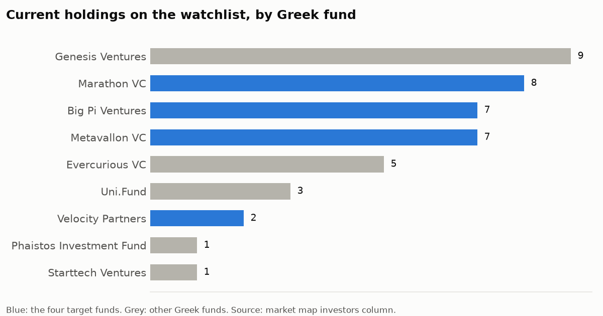
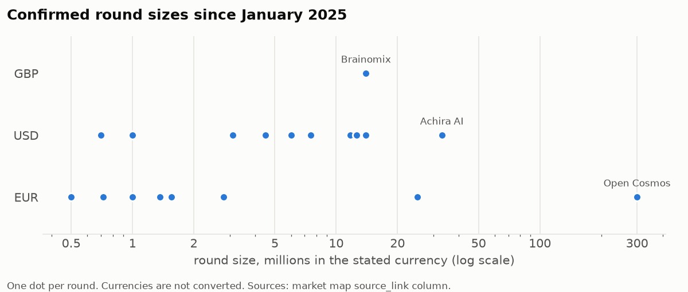
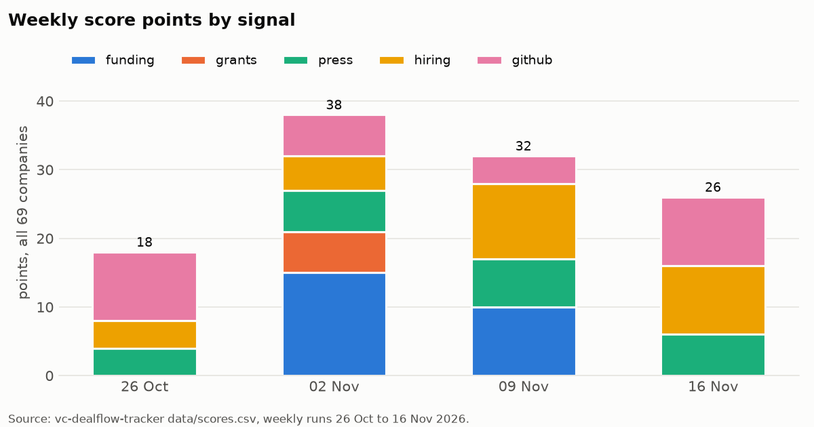

# Case study: six VC questions about Greek deep tech, answered in SQL

Data as of the weekly run of **16 November 2026**. Every table below is the output of a query in [queries/](queries/), run by [build_report.py](build_report.py) against the kit's DuckDB database. Nothing is typed in by hand, and no figure is estimated: a round size is used only when the source records an exact amount, and currencies are never converted.

**The universe:** the 69 companies on the deal-flow tracker's watchlist, which are the Include and Borderline companies of the [Greek Deep Tech Market Map](https://github.com/geve-ops/greek-deeptech-market-map). Weekly signals come from the [deal-flow tracker](https://github.com/geve-ops/vc-dealflow-tracker): GitHub, Google News, job boards and the EU's [CORDIS](https://cordis.europa.eu/) project database. Round sizes, dates and investors come from the market map, which keeps a source link for every company; those links are in the tables that quote a figure.

**The four target funds** are Big Pi Ventures, Marathon VC, Metavallon VC and Velocity Partners. egg (Eurobank) has no tagged holding on the watchlist, so it does not appear.

| # | Question | Short answer |
|---|---|---|
| 1 | [Where is the universe, and how visible is it?](#1-where-is-the-universe-and-how-visible-is-it) | Health & Biotech is the most backed sector; Space & Defense shows the most activity. |
| 2 | [Which funds lead, and do the target funds co-invest?](#2-which-greek-funds-lead-and-do-the-target-funds-co-invest) | Almost never: one shared company across the four. |
| 3 | [How is recent capital spread?](#3-how-is-recent-capital-spread) | Small euro seeds, larger dollar rounds, and one EUR 300M outlier. |
| 4 | [Who brings in EU research money?](#4-who-brings-in-eu-research-money) | Mostly companies no Greek fund holds. |
| 5 | [What drives week-over-week momentum?](#5-what-drives-week-over-week-momentum) | Hiring and GitHub. No funding point came from an actual round. |
| 6 | [Who should a fund call this month?](#6-who-should-a-fund-call-this-month) | Seven companies in the raising window with no Greek investor. |

---

## 1. Where is the universe, and how visible is it?

A fund first wants to know where the companies are and how much it can see of each sector: how many already have a Greek investor, how many have a round size it can trust, and how many showed any activity in the last four weekly runs.

| sector | companies | include | greek_fund_backed | confirmed_round_size | scored_in_4_weeks | pct_of_watchlist |
|---|---:|---:|---:|---:|---:|---:|
| Health & Biotech | 13 | 6 | 10 | 10 | 3 | 18.8 |
| Robotics & Drones | 13 | 7 | 6 | 5 | 4 | 18.8 |
| AI & Machine Learning | 11 | 4 | 4 | 8 | 5 | 15.9 |
| Space & Defense | 11 | 5 | 4 | 6 | 6 | 15.9 |
| Energy & Climate Tech | 8 | 5 | 6 | 5 | 1 | 11.6 |
| Semiconductors & Hardware | 7 | 4 | 4 | 1 | 2 | 10.1 |
| Industrial & Manufacturing Tech | 5 | 4 | 1 | 2 | 1 | 7.2 |
| Quantum & Advanced Computing | 1 | 1 | 0 | 0 | 0 | 1.4 |

<details><summary>SQL: <code>queries/01_sector_coverage.sql</code></summary>

```sql
-- Where is the investable universe, and how much of it can a fund actually see?
-- One row per sector of the watchlist (market map Include + Borderline companies).
WITH clean_rounds AS (
    -- a round size counts only when the text starts with a currency and an amount:
    -- no "~" approximations, no UNVERIFIED figures, no "More than", no acquisitions, no grants
    SELECT company_id
    FROM watchlist
    WHERE regexp_matches(last_round_amount, '^(USD|EUR|GBP) [0-9.]+[MK]')
      AND last_round_amount NOT ILIKE '%grant%'
),
scored AS (
    SELECT company_id
    FROM scores
    GROUP BY company_id
    HAVING sum(week_score) > 0
)
SELECT w.category                                                  AS sector,
       count(*)                                                    AS companies,
       count(*) FILTER (WHERE w.map_status = 'Include')            AS include,
       count(*) FILTER (WHERE w.greek_fund_status = 'current')     AS greek_fund_backed,
       count(r.company_id)                                         AS confirmed_round_size,
       count(s.company_id)                                         AS scored_in_4_weeks,
       round(100.0 * count(*) / sum(count(*)) OVER (), 1)          AS pct_of_watchlist
FROM watchlist AS w
LEFT JOIN clean_rounds AS r ON r.company_id = w.company_id
LEFT JOIN scored       AS s ON s.company_id = w.company_id
GROUP BY w.category
ORDER BY companies DESC, sector;
```
</details>

**So what.**
- Four sectors (Health & Biotech, Robotics & Drones, AI & Machine Learning, Space & Defense) hold 48 of the 69 companies.
- Health & Biotech is the most crowded for a new investor: 10 of its 13 companies already have a current Greek fund.
- Space & Defense has the most companies producing signals (6 of 11) but only 4 with a Greek fund. That is the sector where activity runs ahead of local backing.
- Semiconductors & Hardware has a confirmed round size for only 1 of its 7 companies. Any sizing view of that sector needs primary diligence first.

## 2. Which Greek funds lead, and do the target funds co-invest?

`greek_funds` holds several funds in one cell, so the query splits it into one row per fund and company, then joins the result to itself to find pairs of funds that hold the same company.



| fund | current_holdings | shared_with_another_greek_fund | greek_co_investors | target_fund |
|---|---:|---:|---:|---|
| Genesis Ventures | 9 | 3 | 3 | no |
| Marathon VC | 8 | 1 | 1 | yes |
| Big Pi Ventures | 7 | 2 | 3 | yes |
| Metavallon VC | 7 | 1 | 1 | yes |
| Evercurious VC | 5 | 3 | 4 | no |
| Uni.Fund | 3 | 2 | 2 | no |
| Velocity Partners | 2 | 1 | 2 | yes |
| Phaistos Investment Fund | 1 | 0 | 0 | no |
| Starttech Ventures | 1 | 1 | 2 | no |

<details><summary>SQL: <code>queries/02_fund_overlap.sql</code></summary>

```sql
-- Which Greek funds hold the most watchlist companies, and where do they co-invest?
-- Part A: one row per fund (current holdings only).
WITH holdings AS (
    SELECT company_id, company, trim(unnest(string_split(greek_funds, '|'))) AS fund
    FROM watchlist
    WHERE greek_fund_status = 'current'
),
co AS (
    SELECT h.fund, count(DISTINCT o.fund) AS co_investors,
           count(DISTINCT o.company_id)  AS shared_companies
    FROM holdings AS h
    JOIN holdings AS o ON o.company_id = h.company_id AND o.fund <> h.fund
    GROUP BY h.fund
)
SELECT h.fund,
       count(*)                          AS current_holdings,
       coalesce(c.shared_companies, 0)   AS shared_with_another_greek_fund,
       coalesce(c.co_investors, 0)       AS greek_co_investors,
       h.fund IN ('Big Pi Ventures', 'Marathon VC', 'Metavallon VC', 'Velocity Partners') AS target_fund
FROM holdings AS h
LEFT JOIN co AS c USING (fund)
GROUP BY h.fund, c.shared_companies, c.co_investors
ORDER BY current_holdings DESC, h.fund;
```
</details>

Every pair of Greek funds that currently share a company:

| fund_a | fund_b | shared | companies |
|---|---|---:|---|
| Big Pi Ventures | Evercurious VC | 2 | Anodyne Nanotech, ORamaVR |
| Big Pi Ventures | Starttech Ventures | 1 | ORamaVR |
| Big Pi Ventures | Velocity Partners | 1 | Anodyne Nanotech |
| Evercurious VC | Starttech Ventures | 1 | ORamaVR |
| Evercurious VC | Uni.Fund | 1 | SolidWatts |
| Evercurious VC | Velocity Partners | 1 | Anodyne Nanotech |
| Genesis Ventures | Marathon VC | 1 | Progressive Robotics |
| Genesis Ventures | Metavallon VC | 1 | Feel Therapeutics |
| Genesis Ventures | Uni.Fund | 1 | Terra Robotics |

<details><summary>SQL: <code>queries/02b_fund_pairs.sql</code></summary>

```sql
-- Part B: every pair of Greek funds that currently share a watchlist company.
WITH holdings AS (
    SELECT company_id, company, trim(unnest(string_split(greek_funds, '|'))) AS fund
    FROM watchlist
    WHERE greek_fund_status = 'current'
)
SELECT a.fund                                    AS fund_a,
       b.fund                                    AS fund_b,
       count(*)                                  AS shared,
       string_agg(a.company, ', ' ORDER BY a.company) AS companies
FROM holdings AS a
JOIN holdings AS b ON b.company_id = a.company_id AND a.fund < b.fund
GROUP BY a.fund, b.fund
ORDER BY shared DESC, fund_a, fund_b;
```
</details>

**So what.**
- By count of watchlist holdings, Genesis Ventures (9) leads, ahead of Marathon VC (8), Big Pi Ventures (7) and Metavallon VC (7).
- The four target funds share exactly one company with each other: Anodyne Nanotech, held by Big Pi Ventures and Velocity Partners. Marathon VC and Metavallon VC do not share a single company with another target fund.
- Where Greek funds do co-invest, the partner is usually a smaller early-stage fund: Evercurious VC has 4 Greek co-investors and Genesis Ventures 3. For a target fund, those two are the most likely route to a local syndicate.
- Nine pairs of funds share ten holdings, out of 35 current holdings in all: Greek funds mostly invest in parallel, not in syndicates.

## 3. How is recent capital spread?

Rounds dated January 2025 or later, from the market map's `last_round_amount` and `last_round_date`. A round counts only when the text starts with a currency and an exact amount, the date is not marked UNVERIFIED, and the money is not a grant.



| currency | rounds | total_m | median_m | largest_m | largest_pct_of_total | under_5m |
|---|---:|---:|---:|---:|---:|---:|
| EUR | 10 | 334.93 | 1.18 | 300 | 89.6 | 8 |
| USD | 10 | 94.1 | 6.75 | 33 | 35.1 | 4 |
| GBP | 1 | 14 | 14 | 14 | 100 | 0 |

<details><summary>SQL: <code>queries/03_recent_rounds.sql</code></summary>

```sql
-- How is recent capital spread? Rounds dated January 2025 or later, with a confirmed size.
-- Part A: summary per currency. Currencies are never converted: no exchange rate is assumed.
WITH rounds AS (
    SELECT w.company_id, w.company, w.category,
           regexp_extract(w.last_round_amount, '^(USD|EUR|GBP) ([0-9.]+)([MK])', 1) AS currency,
           TRY_CAST(regexp_extract(w.last_round_amount, '^(USD|EUR|GBP) ([0-9.]+)([MK])', 2) AS DOUBLE)
             / CASE regexp_extract(w.last_round_amount, '^(USD|EUR|GBP) ([0-9.]+)([MK])', 3)
                 WHEN 'K' THEN 1000 ELSE 1 END                                     AS amount_m,
           strptime(left(w.last_round_date, 7), '%Y-%m')::DATE                     AS round_month
    FROM watchlist AS w
    WHERE regexp_matches(w.last_round_date, '^\d{4}-\d{2}')
      AND w.last_round_date NOT ILIKE '%unverified%'
      AND w.last_round_amount NOT ILIKE '%grant%'
)
SELECT currency,
       count(*)                                           AS rounds,
       round(sum(amount_m), 2)                            AS total_m,
       round(median(amount_m), 2)                         AS median_m,
       round(max(amount_m), 2)                            AS largest_m,
       round(100.0 * max(amount_m) / sum(amount_m), 1)    AS largest_pct_of_total,
       count(*) FILTER (WHERE amount_m < 5)               AS under_5m
FROM rounds
WHERE currency <> '' AND round_month >= DATE '2025-01-01'
GROUP BY currency
ORDER BY rounds DESC, currency;
```
</details>

<details><summary>The 21 rounds behind the summary, with sources</summary>

| month | company | sector | amount_as_recorded | source |
|---|---|---|---|---|
| 2026-09 | Open Cosmos (Open Cosmos Aegean) | Space & Defense | EUR 300M | [tech.eu](https://tech.eu/2026/09/14/open-cosmos-secures-eur300m-to-expand-satellite-intelligence-and-connectivity/) |
| 2026-08 | Proxy Foods AI | AI & Machine Learning | USD 6M | [pulse2.com](https://pulse2.com/proxy-foods-ai-raises-6-million-seed-round-to-expand-ai-native-food-rd-platform/amp/) |
| 2026-06 | Acumino | Robotics & Drones | USD 11.7M | [bigpi.vc](https://bigpi.vc/) |
| 2026-06 | Anodyne Nanotech | Health & Biotech | USD 12.6M | [drugdeliverybusiness.com](https://www.drugdeliverybusiness.com/?p=67513) |
| 2026-06 | ClearDrop | Energy & Climate Tech | USD 700K (Signalbase, aggregator) | [genesis-ventures.vc](https://www.genesis-ventures.vc/our-portfolio) |
| 2026-02 | OQ Technology | Space & Defense | EUR 25M EIB venture debt (EUR 13M Series A in 2022-09) | [eib.org](https://www.eib.org/en/press/all/2026-x072-european-financing-for-luxembourgish-satellite-to-smartphone-connectivity-pioneer-oq-technology) |
| 2026-02 | Pallma AI | AI & Machine Learning | EUR 1.36M (USD 1.6M) | [theaiinsider.tech](https://theaiinsider.tech/2026/02/02/pallma-ai-raises-e1-36m-pre-seed-to-secure-autonomous-ai-agents-for-the-enterprise/) |
| 2026-01 | Hoplon AI | Space & Defense | USD 1M | [athenstechcircle.beehiiv.com](https://athenstechcircle.beehiiv.com/p/plugsecure-secures-funding-to-protect-ev-charging-from-cyber-attacks-bdfd) |
| 2026-01 | ORamaVR | Health & Biotech | USD 4.5M | [athenstechcircle.beehiiv.com](https://athenstechcircle.beehiiv.com/p/oramavr-secures-4-5m-late-seed-funding) |
| 2025-10 | Mind The Hack | Space & Defense | EUR 2.8M | [startuprise.co.uk](https://startuprise.co.uk/greek-cybersecurity-startup-mind-the-hack-secures-e2-8m-funding/) |
| 2025-07 | Delian Alliance Industries | Space & Defense | USD 14M | [tech.eu](https://tech.eu/2025/07/29/greek-defence-tech-startup-founded-by-apple-roboticist-raised-14m/) |
| 2025-06 | Bitloops | AI & Machine Learning | EUR 1M (USD 1.2M) | [vestbee.com](https://vestbee.com/insights/articles/bitloops-raises-1-m) |
| 2025-06 | Koios Care | Health & Biotech | EUR 1M | [koios.care](https://www.koios.care/) |
| 2025-03 | Brainomix | Health & Biotech | GBP 14M (USD 18M), later extended to GBP 18.8M (USD 25.4M) | [brainomix.com](https://www.brainomix.com/news/brainomix-series-c/) |
| 2025-03 | PlugSecure | Energy & Climate Tech | EUR 720K (~USD 780K) | [nordic9.com](https://nordic9.com/news/plugsecure-in-a-720k-pre-seed-deal-led-by-apeiron-vc-joined-by-genesis-ventures/) |
| 2025-03 | SquareDev | AI & Machine Learning | EUR 1M investment (Athens Tech Circle); USD 1.18M for a majority stake (CB Insights) | [athenstechcircle.beehiiv.com](https://athenstechcircle.beehiiv.com/p/growing-faster-together-collaboration-the-key-to-business-success) |
| 2025-02 | Achira AI | Health & Biotech | USD 33M | [finder.techleap.nl](https://finder.techleap.nl/news/feed/achira-ai-secures-33m-in-funding) |
| 2025-02 | Keragon | AI & Machine Learning | USD 7.5M | [keragon.com](https://keragon.com/blog/keragon-ai-powered-healthcare-automation-platform-secured-7-5m-seed-round) |
| 2025-02 | Robenso | Robotics & Drones | EUR 500K | [athenstechcircle.beehiiv.com](https://athenstechcircle.beehiiv.com/p/big-moves-in-startup-funding-500k-for-robenso-hdb-s-new-loan-fund-more) |
| 2025-01 | Intryc | AI & Machine Learning | USD 3.1M | [seedtable.com](https://seedtable.com/companies/intryc/funding-rounds/seed-2025-01) |
| 2025-01 | Progressive Robotics | Robotics & Drones | EUR 1.55M | [eu-startups.com](https://www.eu-startups.com/2026/02/from-athens-to-thessaloniki-10-of-the-most-promising-greek-startups-to-keep-an-eye-on-in-2026/) |

<details><summary>SQL: <code>queries/03b_recent_rounds_list.sql</code></summary>

```sql
-- Part B: the rounds behind the summary, each with its first source link from the market map.
WITH rounds AS (
    SELECT w.company_id, w.company, w.category, w.last_round_amount, w.last_round_date,
           regexp_extract(w.last_round_amount, '^(USD|EUR|GBP) ([0-9.]+)([MK])', 1) AS currency,
           strptime(left(w.last_round_date, 7), '%Y-%m')::DATE                     AS round_month
    FROM watchlist AS w
    WHERE regexp_matches(w.last_round_date, '^\d{4}-\d{2}')
      AND w.last_round_date NOT ILIKE '%unverified%'
      AND w.last_round_amount NOT ILIKE '%grant%'
)
SELECT strftime(r.round_month, '%Y-%m')                AS month,
       r.company,
       r.category                                      AS sector,
       r.last_round_amount                             AS amount_as_recorded,
       split_part(c.source_link, ' | ', 1)             AS source
FROM rounds AS r
JOIN companies AS c USING (company_id)
WHERE r.currency <> '' AND r.round_month >= DATE '2025-01-01'
ORDER BY month DESC, r.company;
```
</details>
</details>

Recent rounds left out, and why:

| company | amount_as_recorded | date_as_recorded | reason |
|---|---|---|---|
| Perceptual Robotics | ~GBP 4M (~USD 5.3M) | 2026-07 | approximate amount |
| SolidWatts | ~USD 1.8M (EUR 2.0M per tech.eu) | 2026-03 | approximate amount |
| Terra Robotics | ~EUR 1.8M (USD 2.1M) | 2025-09 to 2025-10 | approximate amount |
| Anacalypsis Therapeutics | EUR 300K (Athens LifeTech Park post, Brain Gain Fund); aggregators list USD 340-344K | 2026-09 (UNVERIFIED) | date unverified |
| Circuits Integrated Hellas | Not disclosed | 2026-09-15 (UNVERIFIED, aggregator) | date unverified |
| Axelera AI | More than USD 250M | 2026-02 | lower bound only |

<details><summary>SQL: <code>queries/03c_recent_rounds_excluded.sql</code></summary>

```sql
-- Part C: recent rounds left out of the summary, and why.
SELECT w.company,
       w.last_round_amount AS amount_as_recorded,
       w.last_round_date   AS date_as_recorded,
       CASE
         WHEN w.last_round_date ILIKE '%unverified%'          THEN 'date unverified'
         WHEN w.last_round_amount ILIKE '%grant%'             THEN 'grant, not a round'
         WHEN w.last_round_amount LIKE '~%'                    THEN 'approximate amount'
         WHEN w.last_round_amount ILIKE 'more than%'           THEN 'lower bound only'
         ELSE 'amount not disclosed'
       END                  AS reason
FROM watchlist AS w
WHERE regexp_matches(w.last_round_date, '^\d{4}-\d{2}')
  AND strptime(left(w.last_round_date, 7), '%Y-%m')::DATE >= DATE '2025-01-01'
  AND NOT (regexp_matches(w.last_round_amount, '^(USD|EUR|GBP) [0-9.]+[MK]')
           AND w.last_round_amount NOT ILIKE '%grant%'
           AND w.last_round_date NOT ILIKE '%unverified%')
ORDER BY reason, w.company;
```
</details>

**So what.**
- The typical euro round is small: the median of the 10 EUR rounds is EUR 1.18M, and 8 of the 10 are under EUR 5M.
- Rounds recorded in dollars are larger: the median of the 10 USD rounds is USD 6.75M.
- The euro total is one company: Open Cosmos's EUR 300M is 89.6% of the EUR 334.93M raised. The EUR total also includes OQ Technology's EUR 25M, which is EIB venture debt, not equity. Medians, not totals, describe this market.
- Six recent rounds are left out because the source gives only an approximation, a lower bound or an unverified date. Axelera AI's "More than USD 250M" is the largest of them.

## 4. Who brings in EU research money?

CORDIS projects that the tracker matched to each company in the latest snapshot. `project_eu_eur_m` is the EU contribution to the **whole project**, shared by all its partners. It is a measure of how big the consortia are, not of the company's own grant income, and it must not be read as company funding.


| company | sector | projects | running | project_eu_eur_m | latest_signed | greek_funds_now |
|---|---|---:|---:|---:|---:|---|
| Core Innovation and Technology | Industrial & Manufacturing Tech | 26 | 13 | 132.1 | 2026 | - |
| Satways | Space & Defense | 18 | 9 | 98.6 | 2026 | - |
| SquareDev | AI & Machine Learning | 13 | 5 | 99.2 | 2026 | - |
| Prisma Electronics | Space & Defense | 10 | 3 | 26.2 | 2025 | - |
| Altus LSA | Robotics & Drones | 9 | 7 | 54.9 | 2024 | - |
| Axelera AI | Semiconductors & Hardware | 8 | 8 | 243.3 | 2026 | - |
| ORamaVR | Health & Biotech | 7 | 3 | 39.8 | 2023 | Big Pi Ventures , Evercurious VC , Starttech Ventures |
| Think Silicon | Semiconductors & Hardware | 5 | 1 | 23.8 | 2023 | Metavallon VC |
| Augmenta | Robotics & Drones | 4 | 3 | 27.1 | 2022 | - |
| iCOMAT | Industrial & Manufacturing Tech | 4 | 4 | 16.8 | 2025 | Velocity Partners |
| Gizelis Robotics | Robotics & Drones | 3 | 1 | 24 | 2023 | - |
| Seervision | AI & Machine Learning | 3 | 0 | 1.8 | 2020 | - |

<details><summary>SQL: <code>queries/04_eu_grants.sql</code></summary>

```sql
-- Which companies pull in the most EU research money, and are they VC-backed?
-- CORDIS projects matched to each company in the latest weekly snapshot.
-- eu_contribution is the EU contribution to the WHOLE project (all partners), not the company's share.
WITH latest AS (
    SELECT *
    FROM signals
    WHERE signal = 'grant'
      AND snapshot_date = (SELECT max(snapshot_date) FROM signals)
)
SELECT w.company,
       w.category                                              AS sector,
       count(*)                                                AS projects,
       count(*) FILTER (WHERE g.grant_status = 'SIGNED')       AS running,
       round(sum(g.eu_contribution) / 1e6, 1)                  AS project_eu_eur_m,
       year(max(g.event_date))                                 AS latest_signed,
       CASE WHEN w.greek_fund_status = 'current' THEN w.greek_funds ELSE '-' END AS greek_funds_now
FROM latest AS g
JOIN watchlist AS w USING (company_id)
GROUP BY w.company, w.category, w.greek_funds, w.greek_fund_status
ORDER BY projects DESC, project_eu_eur_m DESC, w.company
LIMIT 12;
```
</details>

| eu_grants | companies | greek_fund_backed | pct_backed |
|---|---:|---:|---:|
| has CORDIS projects | 21 | 9 | 42.9 |
| no CORDIS projects | 48 | 26 | 54.2 |

<details><summary>SQL: <code>queries/04b_grants_vs_vc.sql</code></summary>

```sql
-- Grant activity against Greek VC backing, across the whole watchlist.
WITH grant_cos AS (
    SELECT DISTINCT company_id
    FROM signals
    WHERE signal = 'grant'
      AND snapshot_date = (SELECT max(snapshot_date) FROM signals)
)
SELECT CASE WHEN g.company_id IS NOT NULL THEN 'has CORDIS projects' ELSE 'no CORDIS projects' END AS eu_grants,
       count(*)                                                         AS companies,
       count(*) FILTER (WHERE w.greek_fund_status = 'current')          AS greek_fund_backed,
       round(100.0 * count(*) FILTER (WHERE w.greek_fund_status = 'current') / count(*), 1) AS pct_backed
FROM watchlist AS w
LEFT JOIN grant_cos AS g USING (company_id)
GROUP BY eu_grants
ORDER BY eu_grants;
```
</details>

**So what.**
- The five companies with the most CORDIS projects (Core Innovation and Technology 26, Satways 18, SquareDev 13, Prisma Electronics 10, Altus LSA 9) have no Greek fund behind them.
- Across the watchlist, companies with EU projects are less often VC-backed (9 of 21, 42.9%) than companies without (26 of 48, 54.2%).
- Grant-heavy companies are a sourcing list a fund can act on: teams that already run EU consortia and report to the Commission, and that have not raised from local VC. Whether they want equity at all is the first question to ask.
- Axelera AI has fewer projects (8) but the largest project budgets (EUR 243.3M across its projects), all of them still running.

## 5. What drives week-over-week momentum?

The tracker scores each company every week (funding headline 5 points, EU grant signed 3, press 1, new job posting 1, GitHub activity; each signal capped). This query adds the points up by signal for each run and uses `LAG` for the change from the week before.



| run | funding | grants | press | hiring | github | total | companies_scoring | change |
|---|---:|---:|---:|---:|---:|---:|---:|---:|
| 2026-10-26 | 0 | 0 | 4 | 4 | 10 | 18 | 9 | - |
| 2026-11-02 | 15 | 6 | 6 | 5 | 6 | 38 | 9 | 20 |
| 2026-11-09 | 10 | 0 | 7 | 11 | 4 | 32 | 12 | -6 |
| 2026-11-16 | 0 | 0 | 6 | 10 | 10 | 26 | 12 | -6 |

<details><summary>SQL: <code>queries/05_weekly_signals.sql</code></summary>

```sql
-- What is driving the weekly scores? Points by signal for each weekly run, all 69 companies.
SELECT date                                        AS run,
       sum(funding)                                AS funding,
       sum(grants)                                 AS grants,
       sum(press)                                  AS press,
       sum(hiring)                                 AS hiring,
       sum(github)                                 AS github,
       sum(week_score)                             AS total,
       count(*) FILTER (WHERE week_score > 0)      AS companies_scoring,
       sum(week_score) - LAG(sum(week_score)) OVER (ORDER BY date) AS change
FROM scores
GROUP BY date
ORDER BY run;
```
</details>

Every headline that earned funding points:

| run | company | published | source | title |
|---|---|---|---|---|
| 2026-11-02 | Hack The Box | 2026-10-27 | Yahoo Finance | Study Finds Hack The Box Cybersecurity Platform Delivered 330% Return on Investment |
| 2026-11-02 | Open Cosmos (Open Cosmos Aegean) | 2026-10-29 | Lokmat Times | European Space Giant Open Cosmos Eyes Major India Investment After PM Modi Meet |
| 2026-11-02 | Open Cosmos (Open Cosmos Aegean) | 2026-10-29 | The Tribune | European space company Open Cosmos signals India investment interest after CEO meets PM Modi |
| 2026-11-09 | OQ Technology | 2026-11-03 | The Joplin Globe | Momentus Secures Contract to Host OQ Technology 5G Payload on Vigoride-9 Mission |
| 2026-11-09 | OQ Technology | 2026-11-03 | Yahoo Finance | Momentus Secures Contract to Host OQ Technology 5G Payload on Vigoride-9 Mission |
| 2026-11-09 | OQ Technology | 2026-11-03 | www.marketscreener.com | Momentus Inc. Secures Contract To Host OQ Technology 5G Payload On Vigoride-9 Mission |

<details><summary>SQL: <code>queries/05b_funding_headlines.sql</code></summary>

```sql
-- The headlines behind every funding point in the four runs.
-- A funding point needs a new headline tagged "funding" that was published inside that week's window.
SELECT s.snapshot_date      AS run,
       w.company,
       s.event_date         AS published,
       s.source,
       s.title
FROM signals AS s
JOIN watchlist AS w USING (company_id)
JOIN scores    AS sc ON sc.company_id = s.company_id AND sc.date = s.snapshot_date
WHERE s.signal = 'news'
  AND s.news_kind = 'funding'
  AND sc.funding > 0
  AND s.event_date > s.snapshot_date - INTERVAL 7 DAY
ORDER BY run, w.company, s.source;
```
</details>

The Top Movers ranking with and without those points:

| rank | company | momentum | without_funding | rank_without_funding |
|---:|---|---|---|---:|
| 1 | Axelera AI | 10.00 | 10.00 | 1 |
| 2 | Hack The Box | 8.75 | 7.50 | 2 |
| 3 | OQ Technology | 5.50 | 0.50 | 18 |
| 4 | SolidKosmos | 4.00 | 4.00 | 3 |
| 5 | WeatherXM | 3.88 | 3.88 | 4 |
| 6 | Open Cosmos (Open Cosmos Aegean) | 3.75 | 1.25 | 10 |
| 7 | Causaly | 2.75 | 2.75 | 5 |
| 8 | Bota Systems | 2.50 | 2.50 | 6 |
| 9 | TileDB (rebranded Tile.ai) | 2.00 | 2.00 | 7 |
| 10 | Satori Analytics | 1.88 | 1.88 | 8 |

<details><summary>SQL: <code>queries/05c_momentum_check.sql</code></summary>

```sql
-- How much of the Top Movers ranking rests on funding points?
-- The tracker's momentum (as in exercise 4.07), next to the same score with funding points removed.
WITH runs AS (
    SELECT date, DENSE_RANK() OVER (ORDER BY date DESC) AS weeks_back
    FROM (SELECT DISTINCT date FROM scores)
),
weighted AS (
    SELECT s.company_id, s.company, r.weeks_back, s.week_score, s.funding,
           CASE r.weeks_back WHEN 1 THEN 1.0 WHEN 2 THEN 0.5 WHEN 3 THEN 0.25 WHEN 4 THEN 0.125 END AS w
    FROM scores AS s
    JOIN runs AS r USING (date)
    WHERE r.weeks_back <= 4
),
movers AS (
    SELECT company,
           round(sum(w * week_score), 2)                  AS momentum,
           round(sum(w * (week_score - funding)), 2)      AS without_funding,
           max(week_score) FILTER (WHERE weeks_back = 1)  AS this_week
    FROM weighted
    GROUP BY company_id, company
),
ranked AS (
    SELECT *,
           ROW_NUMBER() OVER (ORDER BY momentum DESC, this_week DESC, company)        AS rank,
           ROW_NUMBER() OVER (ORDER BY without_funding DESC, this_week DESC, company) AS rank_without
    FROM movers
    WHERE momentum > 0
)
SELECT rank, company, momentum, without_funding, rank_without AS rank_without_funding
FROM ranked
WHERE rank <= 10
ORDER BY rank;
```
</details>

**So what.**
- Hiring is the signal that grew: 4 points in the first run, 10 to 11 in the last two. GitHub is steady at 4 to 10 points a week. One caveat: the tracker scores each city of a multi-city job as a new role. On 16 November Hack The Box earned the maximum 5 hiring points for 3 new postings, one of them listed six times (exercise 3.06 lists them).
- Funding points made up 25 of the 114 points in the four runs, and none of the six headlines behind them announces a new round: they are a return-on-investment study, reports of investment *interest*, and a payload-hosting contract. The headline classifier matches words like "investment" and "secures".
- That error moves the ranking. OQ Technology is third by momentum, but 18th without funding points; Open Cosmos drops from sixth to tenth. The top two (Axelera AI, Hack The Box) do not change.
- The fix belongs in the tracker: award funding points only when the headline carries an amount or a round label, and keep the rest as press.

## 6. Who should a fund call this month?

Companies whose last dated round was 15 to 24 months before the latest run, the usual gap before the next round, joined to their Greek investors, open job postings and four-week score. Acquired companies are left out.

| company | sector | months_since_round | last_round | greek_funds | open_roles | score_4w | round_source |
|---|---|---:|---|---|---:|---:|---|
| Brainomix | Health & Biotech | 20 | GBP 14M (USD 18M), later extended to GBP 18.8M (USD 25.4M) | - | 0 | 5 | [brainomix.com](https://www.brainomix.com/news/brainomix-series-c/) |
| Bitloops | AI & Machine Learning | 17 | EUR 1M (USD 1.2M) | - | 0 | 2 | [vestbee.com](https://vestbee.com/insights/articles/bitloops-raises-1-m) |
| Corsmed | Health & Biotech | 23 | ~USD 3.5M (EUR 3.3M) | Big Pi Ventures | 3 | 1 | [vestbee.com](https://vestbee.com/insights/articles/corsmed-raises-3-5-m) |
| Keragon | AI & Machine Learning | 21 | USD 7.5M | - | 0 | 1 | [keragon.com](https://keragon.com/blog/keragon-ai-powered-healthcare-automation-platform-secured-7-5m-seed-round) |
| Achira AI | Health & Biotech | 21 | USD 33M | - | 7 | 0 | [finder.techleap.nl](https://finder.techleap.nl/news/feed/achira-ai-secures-33m-in-funding) |
| Intryc | AI & Machine Learning | 22 | USD 3.1M | - | 5 | 0 | [seedtable.com](https://seedtable.com/companies/intryc/funding-rounds/seed-2025-01) |
| Delian Alliance Industries | Space & Defense | 16 | USD 14M | Marathon VC | 2 | 0 | [tech.eu](https://tech.eu/2025/07/29/greek-defence-tech-startup-founded-by-apple-roboticist-raised-14m/) |
| Koios Care | Health & Biotech | 17 | EUR 1M | Evercurious VC | 0 | 0 | [koios.care](https://www.koios.care/) |
| PlugSecure | Energy & Climate Tech | 20 | EUR 720K (~USD 780K) | Genesis Ventures | 0 | 0 | [nordic9.com](https://nordic9.com/news/plugsecure-in-a-720k-pre-seed-deal-led-by-apeiron-vc-joined-by-genesis-ventures/) |
| Progressive Robotics | Robotics & Drones | 22 | EUR 1.55M | Marathon VC , Genesis Ventures | 0 | 0 | [eu-startups.com](https://www.eu-startups.com/2026/02/from-athens-to-thessaloniki-10-of-the-most-promising-greek-startups-to-keep-an-eye-on-in-2026/) |
| Robenso | Robotics & Drones | 21 | EUR 500K | - | 0 | 0 | [athenstechcircle.beehiiv.com](https://athenstechcircle.beehiiv.com/p/big-moves-in-startup-funding-500k-for-robenso-hdb-s-new-loan-fund-more) |
| SquareDev | AI & Machine Learning | 20 | EUR 1M investment (Athens Tech Circle); USD 1.18M for a majority stake (CB Insights) | - | 0 | 0 | [athenstechcircle.beehiiv.com](https://athenstechcircle.beehiiv.com/p/growing-faster-together-collaboration-the-key-to-business-success) |

<details><summary>SQL: <code>queries/06_call_list.sql</code></summary>

```sql
-- Who should a Greek fund call this month?
-- Companies whose last dated round was 15 to 24 months before the latest run (the usual gap
-- to the next round), with who already backs them and what the tracker saw in the last 4 weeks.
WITH latest_run AS (SELECT max(date) AS d FROM scores),
window_cos AS (
    SELECT w.company_id, w.company, w.category, w.stage, w.last_round_amount,
           coalesce(w.greek_funds, '-') AS greek_funds,
           date_diff('month', strptime(left(w.last_round_date, 7), '%Y-%m')::DATE, (SELECT d FROM latest_run))
             AS months_since_round
    FROM watchlist AS w
    WHERE regexp_matches(w.last_round_date, '^\d{4}-\d{2}')
      AND w.stage NOT ILIKE '%exited%'
),
activity AS (
    SELECT company_id,
           sum(week_score)       AS score_4w,
           sum(hiring)           AS hiring_pts,
           sum(github)           AS github_pts,
           sum(press + funding)  AS news_pts
    FROM scores
    WHERE date > (SELECT d FROM latest_run) - INTERVAL 28 DAY
    GROUP BY company_id
),
open_roles AS (
    SELECT company_id, count(DISTINCT item_id) AS open_roles
    FROM signals
    WHERE signal = 'job' AND snapshot_date = (SELECT max(snapshot_date) FROM signals)
    GROUP BY company_id
)
SELECT c.company,
       c.category                          AS sector,
       c.months_since_round,
       c.last_round_amount                 AS last_round,
       c.greek_funds,
       coalesce(r.open_roles, 0)           AS open_roles,
       a.score_4w,
       split_part(m.source_link, ' | ', 1) AS round_source
FROM window_cos AS c
JOIN activity   AS a USING (company_id)
JOIN companies  AS m USING (company_id)
LEFT JOIN open_roles AS r USING (company_id)
WHERE c.months_since_round BETWEEN 15 AND 24
ORDER BY a.score_4w DESC, open_roles DESC, c.company;
```
</details>

**So what.**
- 12 companies are in the window, and 7 of them have no Greek investor: Achira AI, Bitloops, Brainomix, Intryc, Keragon, Robenso and SquareDev.
- Brainomix has the highest four-week score in the window. Achira AI (7 open roles, last round USD 33M) and Intryc (5 open roles, USD 3.1M) list open roles but posted none new in four weeks, so their listings may be stale; exercise 3.05 shows how to check.
- Two of those leads have open questions in the market map: Achira AI's HQ and Greek presence and Brainomix's Greek office are marked UNVERIFIED. That check comes before the first call.
- For existing holders, Corsmed (Big Pi Ventures, 23 months) and Delian Alliance Industries (Marathon VC, 16 months) are inside the window: time to prepare the follow-on decision.

---

## Limits of this analysis

- **Small sample.** 69 companies and four weekly runs. The counts describe this watchlist, not the whole Greek ecosystem, and four weeks cannot show a trend.
- **Selection.** The watchlist is the market map's Include and Borderline companies. Companies the map missed are missing here too.
- **Round data.** Round sizes are the last round only, as recorded in the market map. Six recent rounds are excluded for approximate or unverified figures, and earlier rounds are not counted.
- **Fund tags.** `greek_funds` comes from the market map's `investors` column. A holding a source does not mention is missing.
- **Grants.** CORDIS projects are matched by company name, and the amounts are whole-project EU contributions shared by all partners.
- **Signals.** Funding headlines are tagged by keyword (section 5 shows the cost). A company with no GitHub organisation, job board or EU project can only score through news, so a low score means "nothing visible", not "nothing happening".

The data dictionary and the full list of limits are in [docs/data_dictionary.md](../docs/data_dictionary.md).

To rebuild this page: `python run_all.py` from the repository root, or `python case_study/build_report.py` after `python build_db.py`.
