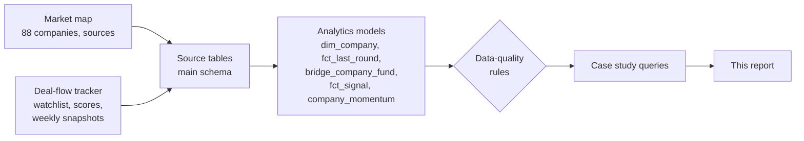

# Greek deep tech through a VC lens: six questions answered in SQL

*Data as of the weekly run of {{as_of}}. Generated by [build_report.py](build_report.py) from the queries in [queries/](queries/): no table and no figure on this page is typed by hand.*

## Executive summary

A Greek early-stage fund looking at deep tech wants to know where the companies are, who already backs them, how big the rounds are, and whom to call next. I took the {{fact:watchlist}} companies that the [Greek Deep Tech Market Map](https://github.com/geve-ops/greek-deeptech-market-map) rates Include or Borderline, joined them to {{fact:runs}} weeks of hiring, GitHub, news and EU-grant signals from my [deal-flow tracker](https://github.com/geve-ops/vc-dealflow-tracker), and answered six questions in SQL.

| # | Question | Answer |
|---|---|---|
| 1 | [Where is the universe, and how visible is it?](#1-where-is-the-universe-and-how-visible-is-it) | {{fact:top4_sector_companies}} of {{fact:watchlist}} companies sit in four sectors. Health & Biotech is the most backed ({{cell:01_sector_coverage|sector=Health & Biotech|greek_fund_backed}} of {{cell:01_sector_coverage|sector=Health & Biotech|companies}}); Space & Defense shows the most activity. |
| 2 | [Which funds lead, and do the target funds co-invest?](#2-which-greek-funds-lead-and-do-the-target-funds-co-invest) | Rarely: the target funds share {{fact:target_shared_companies}} company between them ({{fact:target_shared_names}}). |
| 3 | [How is recent capital spread?](#3-how-is-recent-capital-spread) | Median confirmed round since 2025: EUR {{cell:03_recent_rounds|currency=EUR|median_m}}M and USD {{cell:03_recent_rounds|currency=USD|median_m}}M. One round is {{cell:03_recent_rounds|currency=EUR|largest_pct_of_total}}% of the euro total. |
| 4 | [Who brings in EU research money?](#4-who-brings-in-eu-research-money) | Of the five most active EU project partners, {{fact:grant_top5_backed}} have a Greek fund investor. |
| 5 | [What drives week-over-week momentum?](#5-what-drives-week-over-week-momentum) | Hiring and GitHub. {{fact:funding_points}} of {{fact:total_points}} points came from funding headlines, and none of them announced a round. |
| 6 | [Who should a fund call this month?](#6-who-should-a-fund-call-this-month) | {{fact:window_companies}} companies are in the raising window; {{fact:window_no_greek_fund}} have no Greek investor. |

**Recommendations for a Greek fund**

1. **Source where local money is thin.** Space & Defense and the grant-heavy companies show activity with little Greek VC behind them. Health & Biotech is already crowded.
2. **Build syndicates through the early-stage funds.** The larger Greek funds rarely co-invest with each other; Evercurious VC and Genesis Ventures are the connectors.
3. **Size tickets to the euro market.** Most confirmed euro rounds are under EUR 5M. The median matters more than the total, which a single round dominates.
4. **Start this month's calls with the raising window.** {{fact:window_no_greek_names}} have no Greek investor yet. Settle the facts the market map still marks UNVERIFIED before the first call.
5. **Do not rank on keyword funding signals.** Fix the tracker's headline tagging before using momentum to prioritise companies.

## Data and method

- **Universe:** the {{fact:watchlist}} watchlist companies, out of {{fact:companies}} on the market map. Company facts, round figures and investors come from the market map, which keeps a source link for every company; tables that quote a figure link to it.
- **Signals:** GitHub, Google News, the companies' job boards and the EU's [CORDIS](https://cordis.europa.eu/) database, collected weekly by the tracker over {{fact:runs}} runs.
- **Models:** the free-text fields are parsed once, in [models/](../models/), and every query here reads the cleaned tables. The [data dictionary](../docs/data_dictionary.md) documents every column.
- **Rules:** a round size counts only when the source gives an exact amount and a confirmed date. Approximate (`~`), lower-bound and UNVERIFIED figures are left out and listed. Currencies are never converted. Before this report is built, the data must pass the [data-quality rules](../tests/data_quality/): unique keys, referential integrity, accepted values, score arithmetic and a schema contract.
- **Target funds:** Big Pi Ventures, Marathon VC, Metavallon VC, Velocity Partners and egg (Eurobank), listed in [seeds/target_fund.csv](../seeds/target_fund.csv). egg has no tagged holding on the watchlist.

---

## 1. Where is the universe, and how visible is it?

**Why it matters.** A fund needs to know where the companies are, and how much of each sector it can actually see: how many already have a Greek investor, how many have a round size it can trust, and how many show any activity.

{{table:01_sector_coverage}}

{{sql:01_sector_coverage}}

**So what.**
- Four sectors (Health & Biotech, Robotics & Drones, AI & Machine Learning, Space & Defense) hold {{fact:top4_sector_companies}} of the {{fact:watchlist}} companies.
- Health & Biotech is the most crowded for a new investor: {{cell:01_sector_coverage|sector=Health & Biotech|greek_fund_backed}} of its {{cell:01_sector_coverage|sector=Health & Biotech|companies}} companies already have a current Greek fund.
- Space & Defense has the most companies producing signals ({{cell:01_sector_coverage|sector=Space & Defense|scored_in_4_weeks}} of {{cell:01_sector_coverage|sector=Space & Defense|companies}}) but only {{cell:01_sector_coverage|sector=Space & Defense|greek_fund_backed}} with a Greek fund. Activity runs ahead of local backing there.
- Semiconductors & Hardware has a confirmed round size for {{cell:01_sector_coverage|sector=Semiconductors & Hardware|confirmed_round_size}} of its {{cell:01_sector_coverage|sector=Semiconductors & Hardware|companies}} companies. Any sizing view of that sector needs primary diligence first.

## 2. Which Greek funds lead, and do the target funds co-invest?

**Why it matters.** Co-investors decide who leads, who follows and who brings the next round. The query splits the multi-fund `greek_funds` cell into one row per fund (the `bridge_company_fund` model), then joins that table to itself to find funds that hold the same company.

{{chart:fund_holdings}}

{{table:02_fund_overlap}}

{{sql:02_fund_overlap}}

Every pair of Greek funds that currently share a company:

{{table:02b_fund_pairs}}

{{sql:02b_fund_pairs}}

**So what.**
- By watchlist holdings, Genesis Ventures ({{cell:02_fund_overlap|fund=Genesis Ventures|current_holdings}}) leads, ahead of Marathon VC ({{cell:02_fund_overlap|fund=Marathon VC|current_holdings}}), Big Pi Ventures ({{cell:02_fund_overlap|fund=Big Pi Ventures|current_holdings}}) and Metavallon VC ({{cell:02_fund_overlap|fund=Metavallon VC|current_holdings}}).
- The target funds share {{fact:target_shared_companies}} company between them: {{fact:target_shared_names}}. Marathon VC and Metavallon VC each co-invest with one other Greek fund, and it is not a target fund.
- Where Greek funds do co-invest, the partner is usually a smaller early-stage fund: Evercurious VC has {{cell:02_fund_overlap|fund=Evercurious VC|greek_co_investors}} Greek co-investors and Genesis Ventures {{cell:02_fund_overlap|fund=Genesis Ventures|greek_co_investors}}. They are the likeliest route into a local syndicate.
- {{fact:fund_pairs}} pairs of funds share {{fact:fund_pair_holdings}} holdings, among {{fact:backed_companies}} companies with a current Greek investor: Greek funds mostly invest side by side, not together.

## 3. How is recent capital spread?

**Why it matters.** Round sizes set ticket sizes and ownership targets. Only rounds dated January 2025 or later with a confirmed amount and date are used (`fct_last_round.is_usable`).

{{chart:recent_rounds}}

{{table:03_recent_rounds}}

{{sql:03_recent_rounds}}

The {{fact:recent_usable_rounds}} rounds behind the summary, with sources

{{table:03b_recent_rounds_list}}

{{sql:03b_recent_rounds_list}}

Recent rounds left out, and why:

{{table:03c_recent_rounds_excluded}}

{{sql:03c_recent_rounds_excluded}}

**So what.**
- The typical euro round is small: the median of the {{cell:03_recent_rounds|currency=EUR|rounds}} EUR rounds is EUR {{cell:03_recent_rounds|currency=EUR|median_m}}M, and {{cell:03_recent_rounds|currency=EUR|under_5m}} of them are under EUR 5M.
- Rounds recorded in dollars are larger: the median of the {{cell:03_recent_rounds|currency=USD|rounds}} USD rounds is USD {{cell:03_recent_rounds|currency=USD|median_m}}M.
- The euro total is one company: Open Cosmos's EUR {{cell:03_recent_rounds|currency=EUR|largest_m}}M is {{cell:03_recent_rounds|currency=EUR|largest_pct_of_total}}% of the EUR {{cell:03_recent_rounds|currency=EUR|total_m}}M. The total also includes venture debt ({{fact:recent_debt_rounds}}). Medians, not totals, describe this market.
- Left out: {{fact:recent_excluded_rounds}} recent rounds whose source gives only an approximation, a lower bound or an unverified date. Axelera AI's "More than USD 250M" is the largest of them.

## 4. Who brings in EU research money?

**Why it matters.** Companies that already run EU research consortia have technical depth and non-dilutive funding, and VC screens often miss them. `project_eu_eur_m` is the EU contribution to the **whole project**, shared by all its partners. It shows how large the consortia are, not the company's own grant income, and must not be read as company funding.

{{chart:eu_grants}}

{{table:04_eu_grants}}

{{sql:04_eu_grants}}

{{table:04b_grants_vs_vc}}

{{sql:04b_grants_vs_vc}}

**So what.**
- Of the five companies in the most CORDIS projects ({{fact:grant_top5}}), {{fact:grant_top5_backed}} have a Greek fund investor.
- Across the watchlist, companies with EU projects are less often VC-backed ({{cell:04b_grants_vs_vc|eu_grants=has CORDIS projects|greek_fund_backed}} of {{cell:04b_grants_vs_vc|eu_grants=has CORDIS projects|companies}}, {{cell:04b_grants_vs_vc|eu_grants=has CORDIS projects|pct_backed}}%) than companies without ({{cell:04b_grants_vs_vc|eu_grants=no CORDIS projects|greek_fund_backed}} of {{cell:04b_grants_vs_vc|eu_grants=no CORDIS projects|companies}}, {{cell:04b_grants_vs_vc|eu_grants=no CORDIS projects|pct_backed}}%).
- Grant-heavy companies are a sourcing list: teams that already deliver EU projects and have not raised from local VC. Whether they want equity at all is the first question to ask.
- Axelera AI has fewer projects ({{cell:04_eu_grants|company=Axelera AI|projects}}) but the largest consortia (EUR {{cell:04_eu_grants|company=Axelera AI|project_eu_eur_m}}M across its projects), {{cell:04_eu_grants|company=Axelera AI|running}} of them still running.

## 5. What drives week-over-week momentum?

**Why it matters.** The tracker ranks companies by momentum, and a fund will act on that ranking. Each week it scores new funding headlines (5 points), signed EU grants (3), other press (1), new job postings (1) and GitHub activity, each capped. The query adds the points up by signal for each run and uses `LAG` for the change from the week before.

{{chart:weekly_signals}}

{{table:05_weekly_signals}}

{{sql:05_weekly_signals}}

Every headline that earned funding points:

{{table:05b_funding_headlines}}

{{sql:05b_funding_headlines}}

The Top Movers ranking with and without those points:

{{table:05c_momentum_check}}

{{sql:05c_momentum_check}}

**So what.**
- Hiring is the signal that grew, from {{fact:hiring_first_run}} points in the first run to {{fact:hiring_latest_run}} in the latest. GitHub is steady at {{fact:github_min}} to {{fact:github_max}} points a week.
- Funding points made up {{fact:funding_points}} of the {{fact:total_points}} points ({{fact:funding_points_pct}}%), and none of the headlines behind them announces a new round: they are a return-on-investment study, reports of investment *interest*, and a payload-hosting contract. The tagger matches words like "investment" and "secures".
- That error moves the ranking. OQ Technology is number {{cell:05c_momentum_check|company=OQ Technology|rank}} by momentum but number {{cell:05c_momentum_check|company=OQ Technology|rank_without_funding}} without funding points; Open Cosmos drops from number {{cell:05c_momentum_check|company=Open Cosmos (Open Cosmos Aegean)|rank}} to number {{cell:05c_momentum_check|company=Open Cosmos (Open Cosmos Aegean)|rank_without_funding}}. The top two do not change.
- A second, smaller error: the tracker scores each city of a multi-city job as a new role. In the latest run Hack The Box earned {{fact:htb_hiring_points_latest}} hiring points for {{fact:htb_new_postings_latest}} new postings. The `fct_signal` model counts each posting once.
- The fix belongs in the tracker: award funding points only when a headline carries an amount or a round label, and count postings by ID.

## 6. Who should a fund call this month?

**Why it matters.** Companies usually raise again 15 to 24 months after their last round, and reaching them before the round opens is how a fund wins allocation. The query joins that window to Greek investors, open postings and the four-week score. Exits are left out.

{{table:06_call_list}}

{{sql:06_call_list}}

**So what.**
- {{fact:window_companies}} companies are in the window, and {{fact:window_no_greek_fund}} have no Greek investor: {{fact:window_no_greek_names}}.
- {{fact:window_top_scorer}} has the highest four-week score in the window. Achira AI ({{cell:06_call_list|company=Achira AI|open_roles}} open postings, last round {{cell:06_call_list|company=Achira AI|last_round}}) and Intryc ({{cell:06_call_list|company=Intryc|open_roles}} open postings, {{cell:06_call_list|company=Intryc|last_round}}) are hiring but posted nothing new in four weeks, so their listings may be stale (exercise 3.05 shows how to check).
- {{fact:window_unverified_names}} have facts the market map still marks UNVERIFIED (column `has_unverified_fact`; details in `dim_company.verification_status`). Settle those before the first call.
- For existing holders, Corsmed ({{cell:06_call_list|company=Corsmed|greek_funds}}, {{cell:06_call_list|company=Corsmed|months_since_round}} months) and Delian Alliance Industries ({{cell:06_call_list|company=Delian Alliance Industries|greek_funds}}, {{cell:06_call_list|company=Delian Alliance Industries|months_since_round}} months) are inside the window: time to prepare the follow-on decision.

---

## Limits of this analysis

- **Small sample.** {{fact:watchlist}} companies and {{fact:runs}} weekly runs. The counts describe this watchlist, not the whole Greek ecosystem, and {{fact:runs}} weeks cannot show a trend.
- **Selection.** The watchlist is the market map's Include and Borderline companies. Companies the map missed are missing here too.
- **Round data.** Round sizes are the last round only, as recorded in the market map. {{fact:recent_excluded_rounds}} recent rounds are excluded for approximate or unverified figures, and earlier rounds are not counted.
- **Fund tags.** `greek_funds` comes from the market map's `investors` column. A holding no source mentions is missing.
- **Grants.** CORDIS projects are matched by company name, and the amounts are whole-project EU contributions shared by all partners.
- **Signals.** Funding headlines are tagged by keyword (section 5 shows the cost). A company with no GitHub organisation, job board or EU project can only score through news, so a low score means "nothing visible", not "nothing happening".

The full list is in the [data dictionary](../docs/data_dictionary.md#limits-of-the-data).

**Reproduce:** `pip install -r requirements.txt`, then `python run_all.py` from the repository root. It rebuilds the database, runs every test and regenerates this page.
