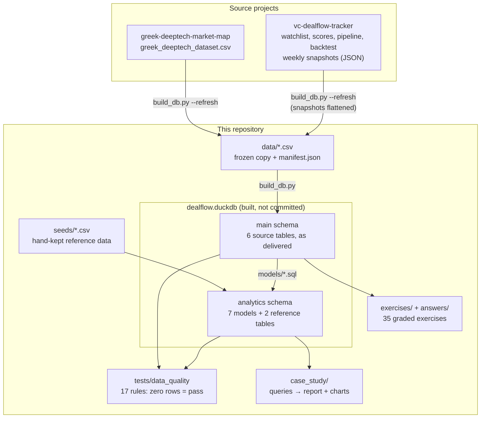
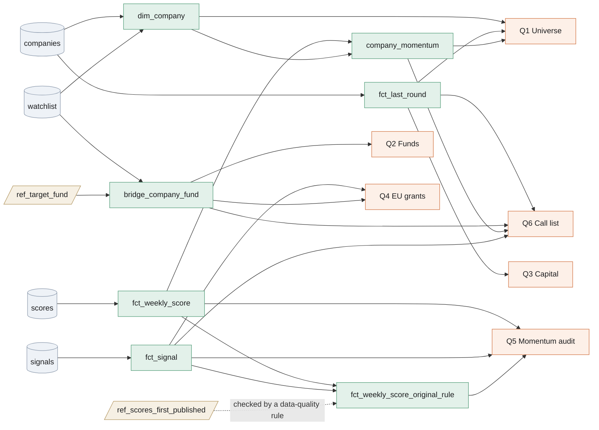
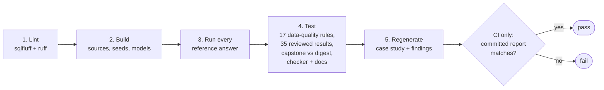

# Architecture

How data moves from the two source projects to the exercises and the case study, and why it is built this way.

## System overview

## Layers

| Layer | Where | What it holds | Who reads it |
|---|---|---|---|
| Sources | `data/*.csv` | A frozen copy of the two source projects. `signals.csv` is the weekly JSON snapshots flattened to one row per item. | `build_db.py` |
| Source tables | `main` schema | The CSVs loaded as delivered, free text and all. | The exercises, which teach how to clean them. |
| Reference data | `seeds/*.csv` → `analytics.ref_*` | Hand-kept lists: the target funds, and the tracker's scores as first published. | Models, data-quality rules |
| Models | `models/*.sql` → `analytics` schema | Cleaned, typed tables with a stated grain: one parse of each messy field, used everywhere. | The case study |
| Tests | `tests/` | Data-quality rules, the reviewed result of every exercise, the checker's own rules, and checks that the docs match the repository. | `run_all.py`, CI |
| Outputs | `case_study/README.md`, `case_study/charts/`, the findings on `README.md` | Generated from the queries. Nothing typed by hand. | Readers |

## Model lineage

Which source tables each model reads, and which models each case study question uses. Read left to right.

## Models

Each model is one SQL file that creates one table. Files run in name order, so a model can read the models before it. The naming follows common analytics-engineering practice: `dim_` for entities, `fct_` for events or measurements, `bridge_` for many-to-many links, `ref_` for seeds.

| Model | Grain | Built from | Purpose |
|---|---|---|---|
| `ref_target_fund` | fund | `seeds/target_fund.csv` | The funds the analysis is for. |
| `ref_scores_first_published` | run × company | `seeds/scores_first_published.csv` | The tracker's weekly scores as first published, before its scoring fix. |
| `dim_company` | company (88) | `companies`, `watchlist` | One clean row per company: sector, founding year, watchlist flag, first source link, fund status. |
| `bridge_company_fund` | company × fund | `watchlist.greek_funds` | The multi-fund text cell split into rows, with current and target flags. |
| `fct_last_round` | company (88) | `companies` | The last round parsed into currency, amount and month, with an amount status and a date status. `is_usable` is the single rule for which rounds count. |
| `fct_signal` | snapshot × company × signal × item | `signals` | One row per item. Job postings that boards repeat once per city are collapsed, with the cities listed. |
| `fct_weekly_score` | run × company | `scores` | Scores with each run's position and momentum weight. |
| `company_momentum` | company (69) | `fct_weekly_score` | The tracker's Top Movers ranking, plus the same ranking without funding points. |
| `fct_weekly_score_original_rule` | run × company | `fct_weekly_score`, `fct_signal` | Each weekly score as the tracker's original rules gave it, rebuilt from the raw signals and checked row for row against `ref_scores_first_published`. |

## Design decisions

- **Parse once, in SQL.** Free-text round amounts, dates and fund lists are parsed in one model each. Every query that needs a round size uses `fct_last_round.is_usable`, so the rule for what counts cannot drift between queries.
- **Never estimate.** A model fills an amount only when the source gives an exact one. Approximate, lower-bound and unverified values keep their text and get a status instead of a number. Currencies stay separate.
- **Keep the source layer untouched.** The exercises run on the source tables, so a learner meets the real mess, and the models show one way to clean it.
- **Test the data, not only the code.** The data-quality rules check keys, references between tables, accepted values, score arithmetic, the grain of each model, and a schema contract for the source tables. Each rule is a query that returns the rows breaking it. Breaking the data on purpose (a duplicate company, a wrong score, an unknown signal type, a future date, an orphan row, an approximate amount given a number, a changed column type, a fund name with spaces) makes the matching rule fail.
- **Audit upstream, not only here.** Section 5 of the case study found two errors in the tracker's scoring. The fix went to the tracker, and the tracker rescored its history. This repository keeps the scores as first published, as a seed, and a model that rebuilds them from the raw signals, so the audit stays reproducible after the fix.
- **Generated reports.** Tables, charts and every number in the case study text come from queries (`{{table:…}}`, `{{fact:…}}`, `{{cell:…}}` placeholders). If the data changes, the report changes with it, and CI fails if the committed report no longer matches the data.
- **Docs are tested too.** The counts the front page states (exercises, models, data-quality rules) are checked against the repository, so the description cannot drift from the code.
- **Commit the data, build the database.** The CSVs are small and diff well. The DuckDB file is binary, changes with every build and depends on the DuckDB version, so it is built in about a second instead.
- **Freeze, then refresh on purpose.** The data is a snapshot (see `data/manifest.json`). `python run_all.py --refresh` pulls new data; the reviewed exercise results then fail until a person checks them and accepts them with `--update-expected`.

## Quality gates

`python run_all.py` runs these in order and stops at the first failure. CI runs the same command on every push.

1. SQL lint (`sqlfluff`, rules in `.sqlfluff`) and Python lint and format checks (`ruff`, rules in `pyproject.toml`).
2. Build: source tables, seeds, models. A model that fails to run stops the build with its file name.
3. Every reference answer runs.
4. Tests: the data-quality rules, each exercise against its reviewed result, the capstone against the published tracker digest, the checker's comparison rules, and the counts stated in the docs.
5. The case study and the front-page findings are regenerated. In CI, `git diff --exit-code` then checks that the committed report matches.
