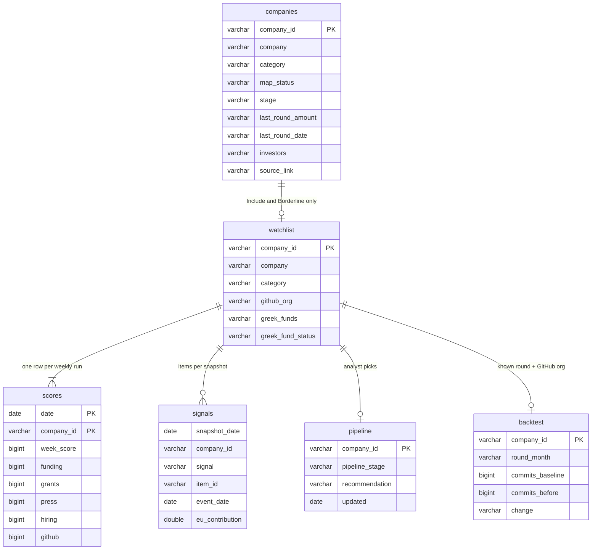

# Data dictionary

The database has six tables, built by `build_db.py` from the CSV files in [data/](../data/). The data runs to the weekly run of 16 November 2026; [data/manifest.json](../data/manifest.json) records the source commits it was copied from.

| Table | Rows | One row per | Source |
|---|---:|---|---|
| `companies` | 88 | company on the market map | [greek-deeptech-market-map](https://github.com/geve-ops/greek-deeptech-market-map) `data/greek_deeptech_dataset.csv` |
| `watchlist` | 69 | tracked company (map status Include or Borderline) | [vc-dealflow-tracker](https://github.com/geve-ops/vc-dealflow-tracker) `data/watchlist.csv` |
| `scores` | 276 | company per weekly run (69 × 4) | tracker `data/scores.csv` |
| `pipeline` | 8 | company in the analyst pipeline | tracker `data/pipeline.csv` |
| `backtest` | 15 | company with a known round and a GitHub organisation | tracker `data/backtest.csv` |
| `signals` | 2,623 | item seen in a weekly snapshot | tracker `data/snapshots/*.json`, flattened |

## Schema

Every table carries `company_id` (`GRDT-001` to `GRDT-088`), the market map's ID. Join on it, not on `company`: names change ("TileDB (rebranded Tile.ai)"), IDs do not.

The diagram shows the key columns only. All columns are listed below.

## companies

The market map: 88 Greek or Greek-linked deep-tech companies, researched by hand. Most fields are free text written for a reader, so they hold qualifiers such as `UNVERIFIED`, `~` or "sources differ". Parse them with care (exercises 3.02, 3.07, 3.08).

| Column | Type | Meaning |
|---|---|---|
| `company_id` | VARCHAR | Market map ID, `GRDT-001` to `GRDT-088`. Unique. |
| `company` | VARCHAR | Company name, sometimes with a note in brackets. |
| `category` | VARCHAR | One of 8 sectors, e.g. `Robotics & Drones`, `Space & Defense`. |
| `sub_sector` | VARCHAR | Narrower field, free text. |
| `what_they_do` | VARCHAR | One-line description. |
| `founded` | VARCHAR | Founding year as text, e.g. `2021 (CB Insights, Endeavor...)`, `UNVERIFIED`. |
| `hq_greek_link` | VARCHAR | Where the company sits and what ties it to Greece. |
| `stage` | VARCHAR | Funding stage as text, e.g. `Seed`, `Venture debt (after Series A)`, `Exited (acquired by ...)`. |
| `last_round_amount` | VARCHAR | Last round as text, e.g. `USD 11.7M`, `~GBP 4M (~USD 5.3M)`, `Not disclosed`. |
| `last_round_date` | VARCHAR | Date as text: `2026-06-24`, `2026-07`, `2025-03 to 2025-04 (sources differ)`, `UNVERIFIED`. |
| `investors` | VARCHAR | Investors in the last round(s), free text. |
| `website` | VARCHAR | Company website. |
| `source_link` | VARCHAR | Sources for the row, ` \| `-separated URLs. The case study cites the first one. |
| `map_status` | VARCHAR | `Include`, `Borderline`, `Exclude` (not Greek or not deep tech) or `Hold` (not enough evidence). |
| `verification_status` | VARCHAR | What was and was not verified, free text. |
| `notes` | VARCHAR | Research notes. |
| `last_verified` | DATE | Date the row was last checked. |
| `github_org` | VARCHAR | GitHub organisation, if any. |
| `linkedin_url` | VARCHAR | LinkedIn company page, if found. |

## watchlist

The 69 companies the tracker follows every week: the market map's Include and Borderline rows, plus the handles the tracker needs and the Greek fund tags.

| Column | Type | Meaning |
|---|---|---|
| `company_id` | VARCHAR | Market map ID. Unique. |
| `company`, `category`, `map_status`, `website` | VARCHAR | As in `companies`. |
| `linkedin_url`, `linkedin_source` | VARCHAR | LinkedIn page and how it was found. |
| `github_org`, `github_source` | VARCHAR | GitHub organisation and how it was matched. 22 of 69 have one. |
| `careers_url` | VARCHAR | Careers page used for job postings. |
| `jobs_source` | VARCHAR | Where job postings come from: `workable`, `ashby`, `recruitee`, `breezy`, `careers_page`, `none`, or NULL (no source). |
| `jobs_source_ref` | VARCHAR | Board account or URL for `jobs_source`. |
| `news_terms` | VARCHAR | Search terms used for Google News. |
| `greek_funds` | VARCHAR | Greek funds that hold or held the company, ` \| `-separated, e.g. `Big Pi Ventures \| Evercurious VC`. NULL when none is known. |
| `greek_fund_status` | VARCHAR | `current`, `exited (company acquired)`, `exited (fund sold its stake)`, or NULL. |
| `greek_funds_source` | VARCHAR | Where the fund tags come from (the market map's `investors` column and its sources). |
| `sub_sector`, `what_they_do`, `hq_greek_link`, `stage`, `last_round_amount`, `last_round_date`, `investors`, `verification_status` | VARCHAR | Copied from `companies`. |

## scores

The tracker's weekly score, one row per company per run (26 October, 2, 9 and 16 November 2026).

| Column | Type | Meaning |
|---|---|---|
| `date` | DATE | Date of the weekly run. With `company_id`, the key. |
| `company_id`, `company` | VARCHAR | The company. |
| `week_score` | BIGINT | Sum of the five signal columns. |
| `funding` | BIGINT | 5 points per new headline tagged `funding`, max 10. |
| `grants` | BIGINT | 3 points per newly signed EU grant, max 6. |
| `press` | BIGINT | 1 point per other new headline, max 3. |
| `hiring` | BIGINT | 1 point per new job posting, max 5. |
| `github` | BIGINT | Points for new GitHub activity (repos pushed, commits), capped; bot commits score nothing. |

Momentum (exercise 4.07) is `week_score` of the latest run + 0.5 × the run before + 0.25 × two runs back + 0.125 × three runs back.

## signals

Every item in every weekly snapshot, flattened by `build_db.py`. A snapshot lists everything visible that week, so an open job appears once per week it stays open. **Filter to one `snapshot_date` unless you are comparing weeks.** 51 of the 69 companies have at least one item.

| Column | Type | Applies to | Meaning |
|---|---|---|---|
| `snapshot_date` | DATE | all | Date of the weekly run. |
| `company_id` | VARCHAR | all | The company. |
| `signal` | VARCHAR | all | `github_repo`, `news`, `job` or `grant`. |
| `item_id` | VARCHAR | all | Stable ID of the item (`org/repo`, news ID, job ID, CORDIS project ID). Not unique: a job open in several cities is listed once per city with the same `item_id`, so count postings with `count(DISTINCT item_id)`. |
| `title` | VARCHAR | all | Repo name, headline, job title or project title. |
| `url` | VARCHAR | all | Link to the item. News links go through Google News. |
| `event_date` | DATE | all | Repo's last push, headline or job publish date, or grant signature date. NULL for 34 job rows whose board gives no date. |
| `source` | VARCHAR | all | GitHub organisation, news outlet, job board, or `CORDIS`. |
| `news_kind` | VARCHAR | news | `funding` or `press`, tagged by keyword. |
| `lang` | VARCHAR | news | `en` or `el`. |
| `location` | VARCHAR | job | Job location as given by the board. |
| `stars` | INTEGER | github_repo | GitHub stars. |
| `window_commits` | INTEGER | github_repo | Commits in that week's window. |
| `window_commits_bot` | INTEGER | github_repo | Of those, commits by bots. |
| `is_fork` | BOOLEAN | github_repo | The repo is a fork. |
| `grant_acronym` | VARCHAR | grant | CORDIS project acronym. |
| `eu_contribution` | DOUBLE | grant | EU contribution to the **whole project** in EUR, shared by all partners. Not the company's own share. |
| `grant_status` | VARCHAR | grant | `SIGNED` (running), `CLOSED` or `TERMINATED`. |

## pipeline

Gerald's hand-kept analyst pipeline: the 8 companies picked from the watchlist for a closer look.

| Column | Type | Meaning |
|---|---|---|
| `company_id`, `company` | VARCHAR | The company. |
| `pipeline_stage` | VARCHAR | `Track` or `Memo`. |
| `recommendation` | VARCHAR | e.g. `Engage`, `Track only`, `Update memo`. |
| `next_action` | VARCHAR | The next step. |
| `owner` | VARCHAR | Who owns the next step. |
| `risk_notes` | VARCHAR | Main risks. |
| `memo_market`, `memo_edge`, `memo_risks`, `memo_terms` | VARCHAR | Memo notes, filled for the `Memo` stage. |
| `updated` | DATE | Last update. |

## backtest

Did GitHub commits change in the months before a known round? One row per company with a dated round and a GitHub organisation.

| Column | Type | Meaning |
|---|---|---|
| `company_id`, `company`, `github_org` | VARCHAR | The company and its GitHub organisation. |
| `round_month` | VARCHAR | Month of the round, `YYYY-MM`. |
| `round` | VARCHAR | Round size as text. |
| `repos_counted` | BIGINT | Public repos with commits in the windows. |
| `commits_baseline` | BIGINT | Commits in the baseline window, well before the round. |
| `commits_before` | BIGINT | Commits in the window just before the round. |
| `change` | VARCHAR | `rose`, `fell`, `flat` or `no activity`. |
| `capped` | BOOLEAN | The commit count hit the API's page limit. |

## Limits of the data

- **Small and recent.** 69 companies and four weekly runs. Enough to practise SQL and to describe this watchlist; not enough to show a trend or to test a model. The backtest has 15 rows.
- **The universe is a selection.** The market map is one researcher's list of Greek and Greek-linked deep tech. Companies it missed are missing everywhere, and `Borderline` companies have a weaker Greek link.
- **Free-text fields.** Round sizes, dates, stages and founding years are text with qualifiers. The exercises and the case study use a value only when it parses cleanly and is not marked `UNVERIFIED` or approximate (`~`); they never fill a gap with an estimate.
- **Last round only.** `last_round_amount` is the most recent round. Total capital raised is not in the data.
- **No currency conversion.** Amounts stay in the currency the source gives. Adding EUR to USD would need an exchange rate the data does not contain.
- **Fund tags.** `greek_funds` comes from the market map's `investors` column. A holding the sources do not mention is missing, and egg (Eurobank) has no tagged holding.
- **Grants are matched by name.** CORDIS projects are found by searching for the company's name, so a false match is possible, and `eu_contribution` is the whole project's EU budget.
- **Signals see only what is public.** 22 companies have a GitHub organisation and 38 a job board or careers page. A company with neither scores only through news, so a low score means "nothing visible", not "nothing happening".
- **Keyword tagging.** `news_kind = 'funding'` is a keyword match. The case study shows that none of the six headlines that earned funding points in the four runs announced an actual round.
- **Repeated job rows.** Workable lists a multi-city job once per city. The 16 November snapshot has 95 job rows but 74 distinct postings. The tracker's hiring points count each row as a new role, so a multi-city posting can earn more than one point (the cap of 5 per week limits the effect).
- **Snapshot dates.** `event_date` comes from the source; some job boards give none (NULL), and Google News dates can differ by a day from the outlet's own.
